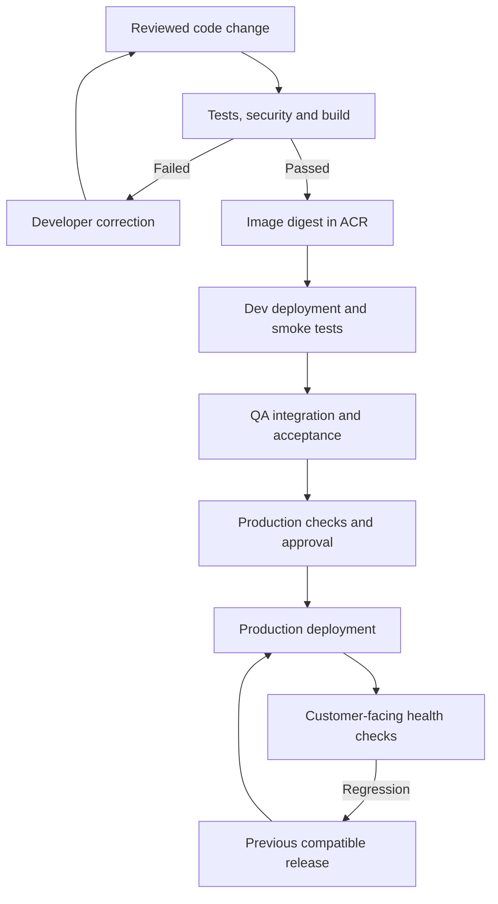

These answers use an example **Azure DevOps → ACR → AKS** project. Adapt experience statements to your actual work.

The complete pipeline, deployment template, Python script, and explanations are in volkswagen-devops-development-interview-guide.md[volkswagen-devops-development-interview-guide.md](sandbox:/workspace/scratch/8dc6806ebb9b/volkswagen-devops-development-interview-guide.md).

---

**1. How do you onboard a project from code to release management across Dev, QA, and production?**

“I start by understanding the application, its dependencies, build process, security requirements, and availability targets. Then I establish a repeatable path from a reviewed code change to a monitored production release.”

| Step | What I establish |
|---|---|
| Application discovery | Technology stack, build commands, tests, dependencies, traffic and recovery requirements |
| Repository setup | Branch protection, reviewers, ownership, build validation and versioning |
| Infrastructure | Reproducible Dev, QA and production environments using Terraform or Bicep |
| Access | Least-privilege identities, service connections and environment permissions |
| Configuration | External configuration and secrets; no environment credentials in source |
| CI | Tests, security checks, container build, scanning and artifact publication |
| CD | Deployment, environment-specific validation, approvals and promotion |
| Operations | Monitoring, alerts, runbooks, backups and rollback procedures |

For containers, I **build once and promote the same image digest**. Configuration changes between environments; the application artifact stays the same.



Azure DevOps environments provide deployment history and resource checks. **Approvals are configured on protected resources outside the YAML**, so modifying pipeline YAML does not modify those checks. [Microsoft Learn](https://learn.microsoft.com/en-us/azure/devops/pipelines/process/environments?view=azure-devops\&utm_source=chatgpt.com)

---

**2. How do you automate CI/CD when many tools are involved?**

“I use the pipeline as the orchestrator. Every tool has a defined input, output, exit status, timeout, and failure policy.”

| Activity | Example tooling | Expected output |
|---|---|---|
| Build | Maven, npm, pip | Application package |
| Testing | JUnit, pytest, Jest | Test results and coverage |
| Code analysis | SonarQube or equivalent | Quality/security gate |
| Dependency/source security | SCA, SAST, secret scanners | Findings and exceptions |
| Container build | Docker/BuildKit | Candidate image |
| Image security | Trivy | Scan report and SBOM |
| Publication | ACR | Immutable image digest |
| Infrastructure | Terraform/Bicep | Reviewed infrastructure changes |
| Deployment | Helm, manifests or GitOps | Desired release |
| Validation | API/synthetic tests | Deployment evidence |
| Monitoring | Azure Monitor/Application Insights | Release health |

I standardize these steps through reusable templates and publish machine-readable reports. A failed gate stops downstream deployment.

I retry transient connectivity failures with limits. I do not repeatedly rerun failing tests until they happen to pass.

For access, Azure Resource Manager service connections can use **workload identity federation**, avoiding stored client secrets. Production credentials and private-network access stay behind protected resources. [Microsoft Learn](https://learn.microsoft.com/en-us/azure/devops/pipelines/process/templates?view=azure-devops\&utm_source=chatgpt.com)

---

**3. How do you run security checks on Docker images?**

I check the source, build inputs, final image, and deployed workload.

The sequence is:

1. Use approved, maintained base images.
2. Scan source/dependencies and detect secrets.
3. Build the candidate image.
4. Scan OS packages, application packages and relevant image configuration.
5. Generate an SBOM.
6. Apply the security policy before publication.
7. Reassess images after deployment because new vulnerabilities appear.

Example:

```bash
IMAGE=acrdemo.azurecr.io/orders-api:123

trivy image \
  --scanners vuln,secret \
  --severity HIGH,CRITICAL \
  --exit-code 1 \
  --format json \
  --output image-scan.json \
  "$IMAGE"
```

Matching findings cause a nonzero exit code, stopping the pipeline. Scanner execution failures must also fail the stage.

Generate an SBOM:

```bash
trivy image \
  --format cyclonedx \
  --output image-sbom.cdx.json \
  "$IMAGE"
```

Image assessment should be complemented by non-root execution, restricted capabilities, secret management, and network controls. A vulnerability scan does not prove complete application security. [Trivy](https://trivy.dev/latest/docs/target/container_image/?utm_source=chatgpt.com)

Defender for Cloud can provide ongoing assessment of supported registry and running container images. [Microsoft Learn](https://learn.microsoft.com/en-us/azure/defender-for-cloud/agentless-vulnerability-assessment-azure?utm_source=chatgpt.com)

---

**4. What production Kubernetes issues have you faced?**

Use incidents you actually handled. Common examples include:

| Issue | Investigation | Typical correction |
|---|---|---|
| CrashLoopBackOff | Previous logs, termination reason, configuration | Fix startup/configuration problem |
| OOMKilled | Memory limits, historical peaks, heap/cache/concurrency | Fix excessive consumption and right-size resources |
| Pending Pods | Scheduling events, requests, taints, affinity, capacity | Restore suitable placement/capacity |
| ImagePullBackOff | Image reference, registry permissions, networking | Correct image/authentication/connectivity |
| Readiness failures | Probe behavior and dependencies | Fix availability or probe configuration |
| Ingress latency/5xx | Target health, saturation, application traces | Mitigate bottleneck or faulty release |
| Storage failures | CSI events, attachment, AZ placement | Restore storage access and correct placement |

Useful commands:

```bash
kubectl get pods -n orders -o wide
kubectl describe pod orders-api-pod -n orders
kubectl logs orders-api-pod -n orders -c api --previous
kubectl get events -n orders --sort-by=.metadata.creationTimestamp
kubectl top pods -n orders --containers
kubectl describe node worker-1
```

`kubectl top` requires a metrics API. [Kubernetes](https://kubernetes.io/docs/tasks/debug/debug-application/debug-pods/?utm_source=chatgpt.com)

Explain an incident in this order:

**Customer impact → evidence → mitigation → root cause → prevention → measured result.**

For example, describe how you correlated a release with failures, recovered service, reproduced the problem, and added a preventive check. Use actual evidence; do not invent an incident or improvement percentage.

---

**5. How do you write CI/CD pipelines?**

“I define triggers, agent requirements, stages, dependencies, credentials, reports, and release gates. I keep the pipeline in source control and reuse reviewed templates.”

A CI-stage example:

```yaml
trigger:
  branches:
    include:
      - main

pool:
  name: isolated-ci-linux

variables:
  image: acrdemo.azurecr.io/orders-api:$(Build.BuildId)

stages:
  - stage: CI
    jobs:
      - job: ValidateImage
        steps:
          - checkout: self

          - bash: |
              set -euo pipefail
              python3 -m venv .venv
              .venv/bin/pip install -r requirements-dev.txt
              .venv/bin/pytest

          - bash: |
              set -euo pipefail
              docker build -t "$(image)" .
              trivy image \
                --scanners vuln,secret \
                --severity HIGH,CRITICAL \
                --exit-code 1 \
                "$(image)"
```

This assumes the agent has the required tools. The full guide adds registry publication, digest capture, and reusable Dev/QA/production deployment stages.

For **Azure Repos**, PR builds are triggered through build-validation branch policies. YAML `pr:` triggers apply to supported GitHub/Bitbucket repositories. [Microsoft Learn](https://learn.microsoft.com/en-us/azure/devops/pipelines/get-started/key-pipelines-concepts?view=azure-devops\&utm_source=chatgpt.com)

I also configure:

- Protected production environments and deployment identities.
- Test/security report publication.
- Deployment and validation timeouts.
- Environment-specific configuration.
- A recovery plan that accounts for database compatibility.

---

**6. What was the recent script you wrote?**

Choose a real automation example. A strong example is a **post-deployment API health checker**.

An answer to adapt:

> “I automated a check that calls the application’s readiness endpoint, validates its HTTP status and JSON response, retries failures within a bounded attempt count, and returns a nonzero exit status when validation fails. The pipeline uses that result to stop promotion.”

Explain why this improves on simply checking whether a connection succeeded:

- An HTTP 500 response must fail.
- HTTP 200 with an HTML login page must fail.
- Malformed JSON must fail.
- JSON reporting an unhealthy application must fail.
- Retries and network timeouts must be bounded.

The guide contains a complete standard-library Python implementation, including redirect rejection and response-size limits. Its expected contract is:

```http
HTTP/1.1 200 OK
Content-Type: application/json

{"status": "ok"}
```

Pipeline usage:

```bash
python3 scripts/check_health.py \
  --url https://qa.orders.example.com/health/ready \
  --attempts 5 --timeout 5 --delay 2
```

A health endpoint is only one check. Add a synthetic business transaction to verify behavior such as authentication, order creation, or data retrieval.

---

**7. Explain a CI/CD process you worked on, including all steps**

A model answer to adapt to your project:

> “Developers open a PR. Required reviews and automated validation run tests, code-quality checks, dependency analysis, and secret detection. After merge, the trusted pipeline builds and scans the container image, publishes it to ACR, and records its digest. We deploy that digest to Dev, validate basic behavior, promote it to QA for integration and acceptance testing, then release to production after the configured checks. We monitor user-facing behavior and retain a compatible previous release for recovery.”

| Phase | What happens |
|---|---|
| PR | Review, build validation, tests and security checks |
| Build | Produce the artifact and evidence |
| Dev | Validate deployment, configuration and basic functionality |
| QA | Integration, acceptance and relevant performance/security testing |
| Production | Controlled deployment and observation |
| Recovery | Restore a compatible image/configuration; handle data changes separately |

Release evidence should identify the commit, image digest, test results, scan reports, configuration version, approvals, and deployment result.

A successful deployment command does not prove the application works. Verify customer-facing behavior and dependency health. Application rollback also does not automatically reverse a database migration.

---

**8. Which Azure services do you use?**

Name services you have actually operated and explain your responsibility.

| Area | Example services | What to explain |
|---|---|---|
| Delivery | Repos, Pipelines, Boards, Artifacts | Branch policies, automation, traceability |
| Containers | AKS, ACR | Deployment, image access, upgrades, troubleshooting |
| Identity/secrets | Entra ID, managed identities, Key Vault | Least privilege and secret integration |
| Networking | VNet, NSG, Private Endpoint, Private DNS | Exposure and connectivity |
| Traffic entry | Application Gateway or Front Door | Routing, TLS and WAF |
| Observability | Azure Monitor, Log Analytics, Application Insights | Logs, metrics, traces and alerts |
| Data | Azure SQL, Storage or another managed store | Connectivity, backup and capacity |
| Configuration | App Configuration | External configuration and feature management |

A credible answer distinguishes **production experience**, **lab experience**, and **theoretical knowledge**.

Azure DevOps is the delivery product suite; AKS, Key Vault, and Azure SQL are Azure cloud services. [Microsoft Learn](https://learn.microsoft.com/en-us/azure/devops/user-guide/services?view=azure-devops\&utm_source=chatgpt.com)

---

**9. What would you like to learn next in Azure DevOps?**

Choose a focused capability and explain its practical value.

Example:

> “I want to deepen my knowledge of secure reusable pipeline templates, federated service connections, environment checks, and package governance in Azure Artifacts. These would help standardize project onboarding. For the development responsibilities, I also want to improve API contract testing and automated release validation.”

Other relevant areas include:

- Azure Test Plans and acceptance-test traceability.
- Azure Boards links from requirements to PRs/builds/releases.
- Azure DevOps REST API automation.
- Ephemeral agents and private-network deployment connectivity.
- Artifact retention and dependency-feed governance.

A focused answer with a business outcome is stronger than listing every service. [Microsoft Learn](https://learn.microsoft.com/en-us/azure/devops/user-guide/services?view=azure-devops\&utm_source=chatgpt.com)

---

**10. What is a REST API?**

REST means **Representational State Transfer**. It is an architectural style based on constraints such as client-server separation, stateless interaction, a uniform interface, cacheability, and layered systems.

A typical REST-style HTTP API exposes **resources** and exchanges representations, often JSON. [ics.uci.edu](https://www.ics.uci.edu/~fielding/pubs/dissertation/rest_arch_style.htm?utm_source=chatgpt.com)

| Request | Purpose | Typical success |
|---|---|---|
| `GET /api/v1/orders/42` | Retrieve an order | `200 OK` |
| `POST /api/v1/orders` | Create an order | `201 Created` |
| `PUT /api/v1/orders/42` | Replace/upsert according to the contract | `200`, `204`, or `201` |
| `PATCH /api/v1/orders/42` | Partially update an order | `200` or `204` |
| `DELETE /api/v1/orders/42` | Delete an order | Often `204 No Content` |

Example request:

```http
POST /api/v1/orders HTTP/1.1
Host: api.example.com
Authorization: Bearer example-token
Content-Type: application/json

{"productId": "P100", "quantity": 2}
```

Example response:

```http
HTTP/1.1 201 Created
Location: /api/v1/orders/42
Content-Type: application/json

{"id": 42, "status": "created"}
```

Important interview points:

- **Stateless:** each request supplies the context needed to process it. Application data can still live in a database.
- **Idempotency:** repeating an identical PUT/DELETE has the same intended effect; responses need not be identical.
- **POST retries:** creation/payment operations need a deliberate deduplication design.
- **PATCH:** not inherently idempotent; it depends on the operation. [rfc-editor.org](https://www.rfc-editor.org/rfc/rfc9110.html?utm_source=chatgpt.com)
- **Errors:** distinguish invalid input, unauthenticated users, forbidden actions, missing resources, conflicts, throttling, and server failures.
- **Security:** HTTPS, validated authentication, authorization, rate limiting, and safe handling of sensitive data.
- **Contract:** document schemas, validation, pagination, versioning, and compatibility with OpenAPI/tests.

HTTP plus JSON alone does not make an API fully RESTful. Strict REST also includes hypermedia; many business APIs implement a practical REST-style subset. [ics.uci.edu](https://www.ics.uci.edu/~fielding/pubs/dissertation/rest_arch_style.htm?utm_source=chatgpt.com)

For DevOps work, API knowledge helps you write deployment tests, interpret failures, configure gateways, and diagnose user complaints even when infrastructure metrics look healthy.

The guide’s syntax and health-script failure/recovery behavior were checked. Live Azure Pipelines, Docker, Trivy, and AKS operations were not executed.
