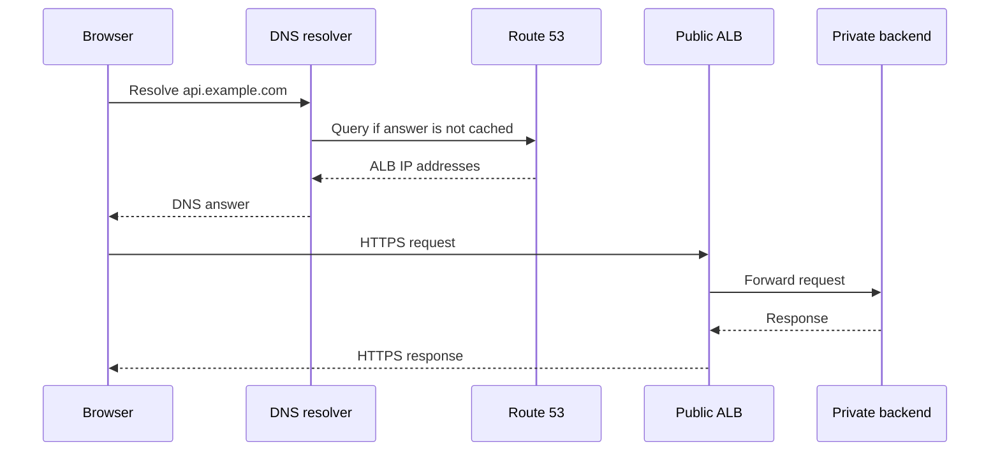

**1. What is the use of Amazon Route 53?**

Amazon Route 53 is AWS’s managed **Domain Name System (DNS)** service. It helps clients find the endpoint associated with a domain such as `www.example.com`. It also supports domain registration and health checks. [Amazon Route 53](https://docs.aws.amazon.com/Route53/latest/DeveloperGuide/Welcome.html?utm_source=chatgpt.com)

Common uses include:

| Use | Example |
|---|---|
| DNS records | Point `api.example.com` to an Application Load Balancer using an alias record |
| Weighted routing | Send most DNS responses to the existing application and a smaller proportion to a new version |
| Latency routing | Choose a regional endpoint based on latency |
| Failover routing | Return a secondary endpoint when the primary becomes unhealthy |
| Private DNS | Resolve internal names such as `orders.internal` inside a VPC |

These routing policies control **DNS responses**. Weighted routing does not guarantee an exact percentage of HTTP requests because clients cache DNS answers. [Amazon Route 53](https://docs.aws.amazon.com/Route53/latest/DeveloperGuide/routing-policy.html?utm_source=chatgpt.com)

**Example architecture:**



**Interview point:** Route 53 resolves the destination; application requests subsequently travel to that endpoint. DNS caching means a failover change may take time to reach clients.

---

**2. What is Git stash?**

`git stash` temporarily saves uncommitted changes and restores a clean working directory. It is useful when you need to switch tasks without committing unfinished work.

**Example:** You are developing a login feature when an urgent production fix arrives:

```bash
# Save unfinished work, including untracked files
git stash push -u -m "WIP: login feature"

# Switch to the branch used for the urgent fix
git switch main

# After completing and committing the fix, return to your feature
git switch feature/login

# Restore the saved work
git stash pop
```

Useful commands:

| Command | Purpose |
|---|---|
| `git stash list` | List saved stashes |
| `git stash show -p 'stash@{0}'` | Inspect changes in the latest stash |
| `git stash apply 'stash@{0}'` | Restore changes and retain the stash |
| `git stash pop` | Restore changes and remove the stash on success |
| `git stash drop 'stash@{0}'` | Delete a particular stash |

By default, stashing includes tracked changes. `-u` also includes untracked files; `-a` additionally includes ignored files. If `pop` encounters conflicts, Git retains the stash so you can resolve them before removing it. [git-stash Documentation](https://git-scm.com/docs/git-stash?utm_source=chatgpt.com)

---

**3. What is the difference between S3 and EBS?**

**S3 provides object storage; EBS provides block storage.** S3 stores objects in buckets, whereas an EBS volume attaches to an EC2 instance and behaves like a disk. [Amazon Simple Storage Service](https://docs.aws.amazon.com/AmazonS3/latest/userguide/Welcome.html?utm_source=chatgpt.com)

| Aspect | Amazon S3 | Amazon EBS |
|---|---|---|
| Storage model | Objects identified by keys | Blocks on a volume |
| Access | HTTP APIs, SDKs and CLI | Operating system through an attached block device |
| Typical workloads | Images, backups, logs, static assets | Boot disks, database files, application disks |
| Sharing | Multiple authorized clients can access objects | Usually attached to one instance |
| Availability scope | Depends on storage class; many classes span multiple AZs | Volume resides in one AZ |
| Backup approach | Versioning and replication | Point-in-time snapshots |

**Example:** For an application running on EC2, use EBS for its operating system and local disk requirements. Store uploaded customer images in S3 so multiple application instances can access them.

**Important exception:** Supported `io1` and `io2` EBS volumes can use Multi-Attach within the same AZ. Concurrent writes require appropriate application coordination or a clustered filesystem; ordinary filesystem sharing can corrupt data. [Amazon EBS](https://docs.aws.amazon.com/ebs/latest/userguide/ebs-volumes-multi.html?utm_source=chatgpt.com)

---

**4. What is the difference between git fetch and git pull?**

| Aspect | `git fetch` | `git pull` |
|---|---|---|
| Downloads remote changes | Yes | Yes |
| Updates remote-tracking references | Yes | Yes |
| Integrates changes into your current branch | No | Yes |
| Typical purpose | Inspect changes before integrating | Fetch and integrate in one operation |

`git pull` performs a fetch and then integrates the selected remote branch using the requested or configured strategy, such as fast-forward, merge or rebase. It does not always create a merge commit. [git-fetch Documentation](https://git-scm.com/docs/git-fetch?utm_source=chatgpt.com)

**Example: inspect before updating your local `main`:**

```bash
git switch main
git fetch origin

# Show remote commits missing from local main
git log --oneline main..origin/main

# Compare local and remote content
git diff main origin/main

# Update only if a fast-forward is possible
git pull --ff-only origin main
```

`--ff-only` fails if the branches have diverged, allowing you to decide how to reconcile their histories. [git-pull Documentation](https://git-scm.com/docs/git-pull?utm_source=chatgpt.com)

---

**5. What is the difference between vertical and horizontal scaling?**

| Aspect | Vertical scaling | Horizontal scaling |
|---|---|---|
| Meaning | Increase resources of an existing instance | Increase the number of instances |
| Example | Change from 2 CPUs to 8 CPUs | Increase application replicas from 2 to 6 |
| Kubernetes example | Increase Pod CPU/memory allocation | HPA increases Pod replicas |
| Main limitation | Maximum machine size; resizing may require disruption | Application must support distributed execution |
| Availability | A larger single instance still needs redundancy | Replicas can be distributed across failure domains |

**Example:** During a sale, an online store can add EC2 instances through an Auto Scaling Group behind an ALB. Scaling policies determine when capacity increases or decreases. [Amazon EC2 Auto Scaling](https://docs.aws.amazon.com/autoscaling/ec2/userguide/what-is-amazon-ec2-auto-scaling.html?utm_source=chatgpt.com)

For horizontal scaling, keep application instances stateless where practical, externalize sessions, and ensure the database can support increased traffic. Adding web servers will not resolve a database bottleneck by itself.

---

**6. What is the role of continuous integration?**

Continuous integration means developers integrate changes frequently into a shared codebase, with automated builds and checks providing fast feedback. Its role is to catch defects and integration problems early. [GitHub Docs](https://docs.github.com/en/actions/about-github-actions/about-continuous-integration?utm_source=chatgpt.com)

A typical CI pipeline performs:

| Stage | Purpose |
|---|---|
| Checkout and dependency installation | Prepare a reproducible build |
| Lint and static analysis | Detect coding and formatting problems |
| Unit and integration tests | Verify application behavior |
| Security checks | Detect exposed secrets and vulnerable dependencies |
| Build and package | Produce a deployable artifact |
| Publish results | Give developers feedback and record the artifact |

**Example:** A developer changes a payment calculation and opens a pull request. CI runs the test suite, detects an incorrect tax calculation, and reports failure. With required status checks configured, the pull request cannot merge until the problem is fixed.

**Interview point:** CI validates and integrates changes. Continuous delivery or deployment takes the validated artifact through the release process; CI alone does not mean automatic production deployment.
