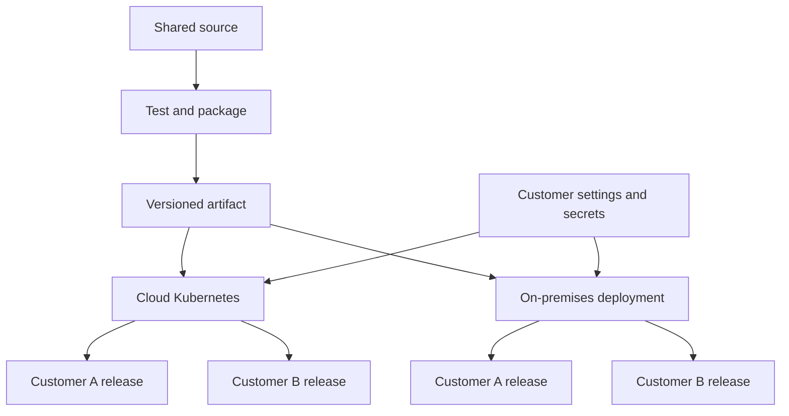
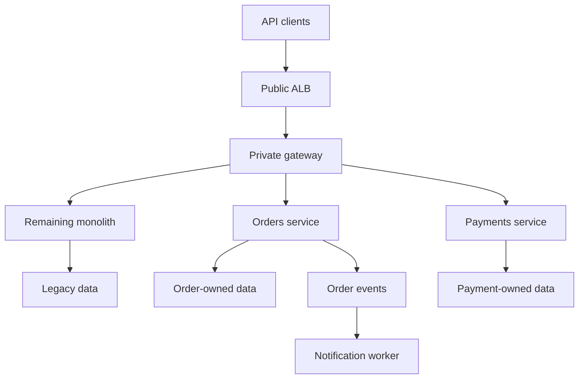

Below are answers for both Wipro rounds. **Adapt the experience examples to your actual projects and responsibilities.**

The wipro-devops-interview-guide.md[wipro-devops-interview-guide.md](sandbox:/workspace/scratch/8dc6806ebb9b/wipro-devops-interview-guide.md) includes all answers plus longer Dockerfile, Kubernetes, Ansible and GitHub Actions examples.

**General round**

**1. What are your day-to-day activities?**

A sample answer:

> “I manage the infrastructure and deployment processes supporting our applications. I start by checking availability, latency, overnight alerts, failed pipelines and backup status. I troubleshoot incidents, review infrastructure and deployment changes, maintain CI/CD pipelines, and support developers with environment issues. I also work on security remediation, upgrades, cost optimization and automation.”

Give one concrete example:

> “If deployments repeatedly fail because of image-pull errors, I investigate registry access and credentials, restore deployments, and improve the pipeline checks and monitoring.”

Explain what you personally own, such as Terraform modules, Kubernetes operations, pipelines or incident response.

**2. A file is used by two customers and must be deployed to Kubernetes and on premises. How would you do it?**

First clarify **what the file contains**:

| File type | Suitable approach |
|---|---|
| Application code/binary | Versioned container image or application package |
| Small nonsecret configuration | ConfigMap in Kubernetes; Ansible-managed file on VMs |
| Credentials/certificates | Secret manager with separate customer access |
| Large dataset/static asset | Object storage, artifact repository or suitable persistent storage |

For application code, build one immutable artifact and deploy the same version to both locations. Keep customer settings and credentials separate.



**Example:** Both customers use application release 42, but each has a separate database endpoint and credentials. Use separate Helm releases/namespaces and enforce isolation through RBAC, NetworkPolicies and application authorization.

If on premises uses VMs, Ansible can deploy the container or corresponding application package. ConfigMaps are limited to **1 MiB**, so they are unsuitable for large files. [Kubernetes](https://kubernetes.io/docs/concepts/configuration/configmap/?utm_source=chatgpt.com)

**3. What is the problem with a large Docker image?**

Assuming the question means a large container image:

- Pulling it takes longer when layers are not cached.
- Deployment, autoscaling and node recovery can become slower.
- It consumes more registry and node disk space.
- Unnecessary packages increase vulnerability and patching work.

Reduce size using multi-stage builds, `.dockerignore`, a suitable base image and a minimal runtime stage. Keep large changing datasets outside the image when appropriate.

**Important:** Image size does not directly determine container RAM usage. Also, deleting a file in a later layer generally leaves its bytes in the earlier layer. [Docker Docs](https://docs.docker.com/build/building/best-practices/?utm_source=chatgpt.com)

**4. Explain the CD part of deploying an application to Kubernetes.**

Start with an already tested and approved image:

1. Select its immutable digest and target environment.
2. Authenticate using a scoped deployment identity.
3. Render and validate Helm/Kustomize manifests.
4. Apply the desired state directly or through GitOps.
5. Wait for rollout completion and readiness.
6. Run smoke tests and critical user journeys.
7. Observe errors and latency before promotion.
8. Restore the previous compatible release if validation fails.

```bash
helm upgrade --install customer-app ./charts/customer-app \
  --namespace production \
  -f environments/production.yaml \
  --set-string image.repository="$IMAGE_REPOSITORY" \
  --set-string image.digest="$IMAGE_DIGEST" \
  --wait --timeout 5m

kubectl rollout status deployment/customer-app \
  --namespace production --timeout=300s
```

Readiness and rollout success do not prove business functionality. Automatic rollback requires pipeline/controller logic, and database migrations must remain compatible with the previous application version. [Kubernetes](https://kubernetes.io/docs/concepts/workloads/controllers/deployment/?utm_source=chatgpt.com)

**5. Vault is running inside a Pod and that Pod is down. How do you troubleshoot?**

First determine whether the failed component is the **Vault server** or a **Vault Agent sidecar**.

```bash
kubectl get pods,statefulsets,pvc -n vault -o wide
kubectl describe pod vault-0 -n vault
kubectl logs vault-0 -n vault --tail=100
kubectl logs vault-0 -n vault --previous --tail=100
kubectl get events -n vault --sort-by=.metadata.creationTimestamp
```

Check:

- OOM, eviction, node failure or failed volume mounts.
- Persistent storage health.
- Vault sealed/unsealed status.
- KMS connectivity if auto-unseal is configured.
- TLS, Service endpoints and network access.
- Raft quorum and surviving peers.

An HA deployment can replace the active server when the required quorum survives. A single instance may recover after restart if its durable storage is intact. **Restarting cannot recover secrets lost from ephemeral storage.** [HashiCorp Developer](https://developer.hashicorp.com/vault/docs/concepts/ha?utm_source=chatgpt.com)

For an Agent failure, check authentication, token renewal and injection errors. Existing credentials might work until their leases expire.

Prevention includes HA, persistent storage, tested snapshots, monitoring and recovery exercises. Do not reinitialize an existing Vault cluster as a troubleshooting shortcut.

**6. How is Azure Key Vault integrated into CI/CD?**

Use an Azure service connection, preferably with workload identity federation, and grant access only to the required secrets. The agent must also have network connectivity to the vault.

Retrieve secrets using `AzureKeyVault@2` or a Key Vault-linked variable group:

```yaml
steps:
  - task: AzureKeyVault@2
    inputs:
      azureSubscription: 'production-federated-connection'
      KeyVaultName: 'customer-production-vault'
      SecretsFilter: 'db-password'
      RunAsPreJob: false

  - bash: python scripts/validate_database_access.py
    env:
      DB_PASSWORD: $(db-password)
```

The consuming script must avoid logging the password or connection string. A private vault needs private connectivity and correct DNS.

For application runtime secrets, prefer the application’s own workload identity so fewer credentials pass through CI/CD. [Microsoft Learn](https://learn.microsoft.com/en-us/azure/devops/pipelines/release/azure-key-vault?view=azure-devops\&utm_source=chatgpt.com)

**7. What do you do if an application is down?**

My priority is to **restore customer service while preserving evidence**.

1. Confirm impact with an external request and critical user journey.
2. Declare the incident and assign technical and communication ownership.
3. Pause conflicting changes and record the timeline.
4. Check recent deployments/configuration changes.
5. Investigate DNS/TLS, load balancer, ingress, Services, Pods and dependencies.
6. Apply an evidence-based rollback, failover or recovery action.
7. Verify recovery from the customer’s perspective.
8. Complete an incident review and track corrective actions.

Useful Kubernetes checks:

```bash
kubectl get pods -n production -o wide
kubectl describe pod <pod-name> -n production
kubectl logs <pod-name> -n production --previous
kubectl get endpointslices -n production
kubectl get events -n production --sort-by=.metadata.creationTimestamp
```

Check the database, cache, queues, credentials and network as well. Healthy Pods do not necessarily mean a healthy application. [Kubernetes](https://kubernetes.io/docs/tasks/debug/debug-application/debug-running-pod/?utm_source=chatgpt.com)

**8. A service has been down for more than two weeks. What would you tell the customer, investigate and prevent?**

**a. Customer communication**

A prolonged outage requires sustained ownership and escalation. A factual update could be:

> “The service remains unavailable for the affected customers. We recognize the prolonged impact. Our confirmed findings are [facts]. We have completed [actions] and are testing [recovery step]. The available workaround is [validated workaround]. We cannot yet provide a reliable restoration time. Our next update will be at [time and time zone].”

Give an ETA when evidence supports it. Separate confirmed findings from hypotheses.

**b. Investigation**

Establish the first failing time, affected customers and last working release. Examine deployment history, traces, network/TLS, dependencies, storage, permissions and provider issues. Identify why rollback, recovery or failover has not restored service.

**c. Prevention**

Fix both the technical cause and the reasons recovery took so long. Improvements might include tested backups, HA, compatible rollback, better runbooks, escalation paths and dependency support. Give each action an owner, deadline and validation criterion.

**9. What contents go into a Dockerfile?**

| Instruction | Purpose |
|---|---|
| `FROM` | Select the base image |
| `WORKDIR` | Set the working directory |
| `COPY` | Copy required files |
| `RUN` | Install dependencies or perform build steps |
| `ENV` | Set nonsecret environment defaults |
| `USER` | Select the runtime user |
| `EXPOSE` | Document the application port |
| `CMD` / `ENTRYPOINT` | Define startup behavior |

Use multi-stage builds when build tools are unnecessary at runtime. Run the application in the foreground as a nonroot user.

`RUN` executes during the build; `CMD`/`ENTRYPOINT` define container startup. `EXPOSE` does not publish a host port. Keep secrets out of image layers and metadata. [Docker Docs](https://docs.docker.com/reference/dockerfile/?utm_source=chatgpt.com)

**10. What contents go into deployment.yaml or a Helm chart?**

A Deployment normally contains:

- API version, kind, name and namespace.
- Replicas and label selectors.
- Rolling-update settings.
- Pod/container image and ports.
- Configuration and secret references.
- Resource requests/limits and probes.
- Volumes, service account and security settings.

A Service, Gateway/Ingress, HPA and NetworkPolicy are separate resources.

| Helm component | Purpose |
|---|---|
| `Chart.yaml` | Chart metadata/version/dependencies |
| `values.yaml` | Default configurable values |
| `templates/` | Kubernetes resource templates |
| `_helpers.tpl` | Shared template helpers |
| `charts/` | Dependency charts |
| `values.schema.json` | Optional values validation |

Use environment overrides for replicas, endpoints and other settings. Keep secret values out of committed values files. `appVersion` does not automatically select the deployed container image. [Kubernetes](https://kubernetes.io/docs/concepts/workloads/pods/?utm_source=chatgpt.com)

**Seven-year DevOps round**

**1. Describe automation and deployment optimization using AWS, Terraform and Ansible.**

A sample answer:

> “For [actual application/fleet], I used Terraform to provision networking, IAM, compute and managed services. Ansible handled operating-system configuration, services and patching. We used reusable modules/roles, reviewed plans, separate environment state and scoped identities. Changes went through a canary and controlled batches, with health checks before continuing.”

Explain optimization through measurable changes: artifact caching, parallel independent jobs, immutable images, dynamic inventory and removal of repetitive manual work.

Clarify ownership: Terraform and Ansible should not independently control the same infrastructure attributes. Quote deployment-time or cost improvements only when you can substantiate them. [HashiCorp Developer](https://developer.hashicorp.com/terraform/language/modules?utm_source=chatgpt.com)

**2. Describe a project involving CI/CD, Docker, Prometheus and Grafana.**

A sample answer:

> “Our pipeline tested the application, ran security checks, built a versioned Docker image and deployed it through development, QA and production. Prometheus collected application/platform metrics, and Grafana provided dashboards for latency, errors and resource pressure. We used post-deployment checks to detect regressions.”

An illustrative incident: a release exhausts the database connection pool. CPU remains normal, but request latency rises. Application metrics and traces expose the dependency bottleneck; the team restores the previous compatible release and fixes pooling behavior.

Explain your personal contribution. Prometheus collects/evaluates metrics; Grafana visualizes data and can provide configured alerting. [Prometheus](https://prometheus.io/docs/introduction/overview/?utm_source=chatgpt.com)

**3. How do you enforce tenant isolation at the API layer?**

Authenticate the caller and establish a **server-verified tenant context**. A tenant ID in a header or URL must be checked against the caller’s membership and permissions.

Authorize every operation and object, including tenant scope in data access:

```sql
SELECT id, status
FROM orders
WHERE tenant_id = :authorized_tenant_id
  AND id = :order_id;
```

Also isolate cache keys, queue messages, object-storage access and audit records. Apply per-tenant quotas/rate limits to control noisy neighbors.

Test that tenant A cannot access tenant B’s objects. Stronger requirements may justify separate databases or infrastructure. CORS and Kubernetes namespaces alone do not enforce API tenant authorization. [OWASP Cheat Sheet Series](https://cheatsheetseries.owasp.org/cheatsheets/Multi_Tenant_Security_Cheat_Sheet.html?utm_source=chatgpt.com)

**4. How would you debug 504 Gateway Timeout errors?**

A 504 means a gateway/proxy did not receive a timely upstream response. Identify **which proxy generated it**. [rfc-editor.org](https://www.rfc-editor.org/rfc/rfc9110.html?utm_source=chatgpt.com)

| Layer | Checks |
|---|---|
| Load balancer/ingress | Access logs, target health, connection/response timings, timeout configuration |
| Application | Request traces, worker queues, connection pools, CPU throttling, memory/GC |
| Database/dependencies | Slow queries, locks, exhausted connections, downstream latency |
| Network | DNS, endpoints, ports, firewall and NetworkPolicy |

Capture the request ID, time, URL and affected tenant. Follow the same request through the layers and compare recent changes.

**Example:** Requests fail after exactly 60 seconds because a database query waits on a lock until the proxy times out. Resolve the lock/query problem; raising the timeout can increase resource consumption.

For legitimately long operations, consider an asynchronous job API.

**5. How would you implement optimistic locking for a REST update?**

Return a strong ETag representing the current version:

```http
ETag: "order-123-v7"
```

Require that version when updating:

```http
PUT /orders/123
If-Match: "order-123-v7"
Content-Type: application/json

{"status":"confirmed"}
```

Enforce the check and update atomically:

```sql
UPDATE orders
SET status = :new_status, version = version + 1
WHERE tenant_id = :authorized_tenant_id
  AND id = :order_id
  AND version = :expected_version;
```

**Example:** Two clients read version 7. Client A updates it to version 8. Client B’s update using version 7 receives `412 Precondition Failed`.

An API requiring conditional updates can return `428 Precondition Required` when `If-Match` is missing. A separate read followed by an unconditional update still has a race. [rfc-editor.org](https://www.rfc-editor.org/rfc/rfc9110.html?utm_source=chatgpt.com)

**6. How would you structure pre-checks, patching and post-validation in Red Hat automation?**

Use three phases:

| Phase | Work |
|---|---|
| `pre_tasks` | Verify connectivity, capacity, application health and backup evidence |
| Main tasks/roles | Drain traffic, patch and reboot if required |
| `post_tasks` | Validate application health, safely rejoin traffic and record results |

Use `serial: 1` or a controlled batch size. Stop subsequent batches when validation fails.

Use `block`/`rescue` for failure handling, and explicitly fail when recovery is incomplete: a successful rescue can otherwise treat the original failure as handled. Never unconditionally rejoin an unhealthy host in `always`. [Ansible Community Documentation](https://docs.ansible.com/projects/ansible/latest/playbook_guide/playbooks_reuse_roles.html?utm_source=chatgpt.com)

For virtualization hosts, verify migration capacity, evacuate workloads and enter maintenance before patching. Guest patching and hypervisor patching require different procedures.

**7. How would you automate secure VM decommissioning?**

Use an auditable process:

1. Verify exact ownership, dependencies and authorization.
2. Drain traffic and stop scheduled work.
3. Retain approved backups/evidence according to policy.
4. Revoke credentials and identities.
5. Account for disks, snapshots, images, backups and replicas.
6. Apply storage-supported sanitization.
7. Delete resources through the owning IaC/provider workflow.
8. Verify completion and retain the record.

**Key point:** `rm` is not secure erasure, and `shred` inside a VM is unreliable as a universal solution for SSDs, thin provisioning and copy-on-write storage.

Cryptographic erase requires suitable encryption and destruction of all relevant key copies. Never destroy a shared key used by other workloads. [CSRC](https://csrc.nist.gov/pubs/sp/800/88/r2/final?utm_source=chatgpt.com)

**8. How do you maintain clarity in large Ansible inventories?**

Use documented conventions and stable, unique inventory aliases.

Examples:

- Groups: `prod_aws_web`, `qa_azure_api`, `prod_onprem_db`.
- Host alias: `prod_aws_web_01`.
- Connection address: defined through `ansible_host`.

Prefer dynamic inventory from authoritative tags or a CMDB. Use `group_vars` for shared settings, `host_vars` for exceptions and an external secret system for credentials. Avoid competing variable definitions and document precedence.

```bash
ansible-inventory -i inventories/production --graph

ansible-playbook -i inventories/production patch.yml \
  --limit prod_aws_web --list-hosts
```

Validate inventory and required ownership/environment tags in CI. [Ansible Community Documentation](https://docs.ansible.com/projects/ansible/latest/inventory_guide/intro_inventory.html?utm_source=chatgpt.com)

**9. What is a three-tier application, and how would Ansible roles manage it?**

| Tier | Example | Responsibility |
|---|---|---|
| Presentation | Frontend/Nginx | Serve UI and accept requests |
| Application | API service | Execute business logic |
| Data | PostgreSQL/MySQL | Persist application data |

Create roles such as `baseline`, `web`, `api`, `database` and `monitoring`, applied to matching host groups.

A role contains tasks, handlers, templates, defaults, files and optional metadata. For example, the API role deploys the approved package, renders configuration and notifies a restart handler only when needed.

Roles improve reuse, testing and ownership. With a managed cloud database, Ansible handles integration rather than installing database software. [Ansible Community Documentation](https://docs.ansible.com/projects/ansible/latest/playbook_guide/playbooks_reuse_roles.html?utm_source=chatgpt.com)

**10. How do you manage custom plugins shared by multiple roles?**

Package them in a **versioned Ansible collection**.

| Collection location | Content |
|---|---|
| `plugins/filter/` | Filters |
| `plugins/lookup/` | Lookup plugins |
| `plugins/modules/` | Custom modules |
| `plugins/module_utils/` | Shared module utilities |

Use fully qualified names, pin collection versions in `requirements.yml`, and install them in the execution environment.

Example:

```jinja2
{{ release_input | company.platform.normalize_release }}
```

This avoids maintaining duplicate plugin copies across roles. Test shared plugins before upgrades because one change can affect many consumers. [Ansible Community Documentation](https://docs.ansible.com/projects/ansible/latest/dev_guide/developing_collections_structure.html?utm_source=chatgpt.com)

**11. What is a cloud-agnostic strategy? How do conditionals help?**

Provide a common interface for application operations while isolating provider-specific implementations.

```yaml
tasks:
  - name: Validate provider
    ansible.builtin.assert:
      that:
        - cloud_provider in ['aws', 'azure', 'gcp']

  - name: Load provider adapter
    ansible.builtin.include_tasks: "providers/{{ cloud_provider }}.yml"

  - name: Apply common application configuration
    ansible.builtin.include_role:
      name: company.platform.application
```

The adapter files handle AWS, Azure or GCP differences and expose documented common variables. Shared application configuration stays reusable.

Containers and Kubernetes help portability, but IAM, storage, load balancers and managed databases still differ. Avoid a large maze of conditionals or assumptions that providers behave identically. [Ansible Community Documentation](https://docs.ansible.com/projects/ansible/latest/playbook_guide/playbooks_conditionals.html?utm_source=chatgpt.com)

**12. How do you reduce miscommunication among multilingual stakeholders?**

Use plain language and clearly separate:

- Confirmed facts and hypotheses.
- Decisions and requested actions.
- Owners, deadlines and blockers.

Include dates and time zones explicitly. Avoid idioms and vague terms such as “next Friday.”

For important decisions, ask stakeholders to confirm their understanding or approve a concise decision record. Keep one authoritative incident/change record and link it in updates. Validate translations of critical instructions where necessary, and use approved translation services for sensitive information.

**13. How would you structure a GitHub Actions pipeline for Kubernetes deployment?**

| Stage | Main activities |
|---|---|
| Validate/test | Lint, tests, source/dependency checks |
| Build/scan | Build container, scan image, enforce policy |
| Publish | Store immutable image digest and release evidence |
| Deploy | Authenticate, render configuration, apply release |
| Verify | Rollout checks, smoke tests, customer-facing metrics |
| Promote/recover | Approve next environment or restore a compatible release |

PRs should run checks without production credentials. Deploy through short-lived OIDC identities and protected environments. Pin actions to reviewed commit SHAs and serialize deployments to each environment. [GitHub Docs](https://docs.github.com/en/actions/how-tos/secure-your-work/security-harden-deployments/oidc-in-aws?apiVersion=2022-11-28\&utm_source=chatgpt.com)

Promote the **same validated image digest** through environments. Private Kubernetes endpoints need a secured runner with private connectivity or GitOps.

The guide contains a workflow distinguishing main-branch builds from promotion of an approved digest.

**14. How would you parameterize the workflow for downstream jobs?**

Use typed inputs, validate the selection, and expose a job output:

```yaml
jobs:
  choose:
    runs-on: ubuntu-latest
    outputs:
      target: ${{ steps.select.outputs.target }}
    steps:
      - id: select
        env:
          REQUESTED_ENV: ${{ inputs.environment || 'dev' }}
        run: |
          case "$REQUESTED_ENV" in
            dev|qa|prod) ;;
            *) exit 1 ;;
          esac
          printf 'target=%s\n' "$REQUESTED_ENV" >> "$GITHUB_OUTPUT"

  deploy:
    needs: choose
    environment: ${{ needs.choose.outputs.target }}
    runs-on: ubuntu-latest
    steps:
      - run: ./scripts/deploy-approved-release.sh
        env:
          TARGET_ENV: ${{ needs.choose.outputs.target }}
```

Configure environment approvals and branch restrictions separately in repository settings.

`GITHUB_ENV` applies to later steps in the same job. Use job outputs for small nonsecret values across jobs and artifacts for files. [GitHub Docs](https://docs.github.com/en/actions/how-tos/write-workflows/choose-what-workflows-do/pass-job-outputs?utm_source=chatgpt.com)

**15. What are the implications of Kubernetes Secrets in etcd without encryption?**

**Base64 encoding is not encryption.** Access to unencrypted etcd data or snapshots can expose passwords, tokens and certificates.

Mitigations include:

- API-data encryption at rest, using an appropriate supported encryption provider.
- Rewriting existing Secrets under the intended encryption configuration.
- Restricted etcd/API access and least-privilege RBAC.
- Protected backups and encryption keys.
- Credential rotation after exposure.
- External vault integration and workload identity where appropriate.

Verify the actual managed-cluster configuration rather than assuming encryption is absent.

Encryption at rest does not prevent an authorized Kubernetes API reader from obtaining a Secret. [Kubernetes](https://kubernetes.io/docs/tasks/administer-cluster/encrypt-data/?utm_source=chatgpt.com)

**16. What is Python’s GIL, and how does it affect multithreaded web services?**

In a GIL-enabled CPython interpreter, the **Global Interpreter Lock** allows only one thread at a time to execute Python bytecode within that interpreter.

CPU-heavy pure-Python processing therefore gains little CPU parallelism from extra threads. Threads can still benefit I/O-bound workloads because blocking I/O commonly releases the GIL. [Python 3.15.0 documentation](https://docs.python.org/3/library/threading.html?utm_source=chatgpt.com)

| Workload | Suitable approach |
|---|---|
| Network/database waiting | Threads or asynchronous I/O with bounded concurrency |
| CPU-heavy Python | Multiple worker processes or a separate worker service |
| Numerical processing | Compatible native libraries that release the GIL |
| Suitable dependencies | Evaluate free-threaded CPython |

Free-threaded builds are optional. Check extension compatibility; an incompatible extension can re-enable the GIL. Async I/O does not make CPU-heavy code parallel, and free-threading still requires correct shared-state synchronization. [Python 3.15.0 documentation](https://docs.python.org/3/howto/free-threading-python.html?utm_source=chatgpt.com)

**17. How would you implement feature toggles?**

Deploy the code with the feature disabled, validate it, then enable it for internal users or a small stable customer cohort. Increase exposure based on errors, latency and business outcomes.

**Example:** Deploy a new checkout algorithm disabled. Enable it for test accounts, then a small cohort. If payment failures rise, disable the flag while the previous code path remains available.

Use access control, audit history, safe defaults, a kill switch and ownership/expiry dates. A runtime configuration service such as AWS AppConfig can support controlled changes. [AWS AppConfig](https://docs.aws.amazon.com/appconfig/latest/userguide/what-is-appconfig.html?utm_source=chatgpt.com)

Flags cannot reverse irreversible database changes. Environment variables injected into a running process generally need process/Pod replacement to change; immediate toggling requires application-supported reload or a flag SDK.

**18. How do you schedule a task every 15 minutes on Windows and Linux?**

**Windows, invoked from PowerShell:**

```powershell
$taskCommand = 'powershell.exe -NoProfile -NonInteractive -File "C:\Ops\healthcheck.ps1"'

schtasks.exe /Create /TN 'OpsHealthCheck' `
  /SC MINUTE /MO 15 /TR $taskCommand

if ($LASTEXITCODE -ne 0) {
    throw 'Scheduled task creation failed'
}
```

Configure the intended service identity, permissions, missed-run policy and overlap behavior. [Microsoft Learn](https://learn.microsoft.com/en-us/windows/win32/taskschd/schtasks?utm_source=chatgpt.com)

**Linux crontab:**

```cron
*/15 * * * * /usr/bin/flock -n /var/lib/myapp/healthcheck.lock /usr/bin/python3 /opt/myapp/healthcheck.py >> /var/log/myapp/healthcheck.log 2>&1
```

This runs at minutes **0, 15, 30 and 45** in the scheduler’s configured time zone. Provision writable lock/log paths, rotate logs and monitor failures. `flock -n` skips an overlapping invocation when the previous run holds the lock. [GitHub](https://github.com/cronie-crond/cronie/blob/master/man/crontab.5?utm_source=chatgpt.com)

These answers cover both four-year Wipro rounds. Adapt the personal-experience examples to work you actually performed.

The wipro-four-year-devops-interview-guide.md[wipro-four-year-devops-interview-guide.md](sandbox:/workspace/scratch/8dc6806ebb9b/wipro-four-year-devops-interview-guide.md) includes expanded explanations, troubleshooting commands, mesh policies and S3 locking permissions.

**Round 1: Microservices and service mesh**

**1. What prerequisites would you request before converting a monolith to microservices?**

First, understand **why the organization wants microservices**: independent releases, selective scaling, better fault isolation or clearer team ownership.

I would request:

| Required input | Purpose |
|---|---|
| Current architecture and dependency map | Identify tightly coupled modules and integrations |
| Business capabilities/service boundaries | Decide what should become an independent service |
| Database schema and transaction requirements | Plan data ownership and consistency |
| API/event contracts | Support communication and independent releases |
| Traffic, latency, availability and recovery requirements | Design capacity and resilience |
| Authentication and data-security requirements | Establish identities and authorization |
| Build, runtime, health-check and shutdown requirements | Prepare services for deployment |
| Tests and observability baseline | Detect migration regressions |
| Ownership, budget and rollback plan | Make the migration operable |

**Example:** Extract the catalog service first while orders and payments remain in the monolith. A routing layer directs catalog requests to the new service.

This incremental approach is commonly called the **strangler fig pattern**. Splitting deployments while retaining tightly coupled data and release dependencies may create a distributed monolith. [AWS Prescriptive Guidance](https://docs.aws.amazon.com/prescriptive-guidance/latest/modernization-decomposing-monoliths/strangler-fig.html?utm_source=chatgpt.com)

**2. How would you design microservices infrastructure?**

For an AWS team already experienced with Kubernetes, an example design is:

| Component | Choice and reason |
|---|---|
| Static frontend | CloudFront with a private S3 origin |
| DNS/security edge | Route 53, TLS certificates, WAF |
| API entry point | ALB and an appropriate gateway/ingress controller |
| Application runtime | EKS nodes in private subnets across AZs |
| Availability | Multiple replicas, zone spreading, readiness and graceful shutdown |
| Scaling | HPA plus node autoscaling |
| Database | Managed RDS/Aurora with appropriate HA and backups |
| Async processing | SQS/EventBridge where asynchronous communication helps |
| Delivery | CI builds images; Argo CD deploys approved desired state |
| Observability | Metrics, logs, traces and synthetic checks |
| Service mesh | Optional, based on demonstrated requirements |

CloudFront can access a private S3 REST origin through Origin Access Control. [Amazon CloudFront](https://docs.aws.amazon.com/AmazonCloudFront/latest/DeveloperGuide/private-content-restricting-access-to-s3.html?utm_source=chatgpt.com)



The architecture supports gradual extraction. Each service should own its data interface, deployment and operational responsibilities.

**Interview point:** Kubernetes and Istio are choices, not prerequisites for microservices. ECS/Fargate may provide a simpler solution when Kubernetes-specific capabilities are unnecessary.

**3. How do you decide the number of control planes and data planes?**

Distinguish **control-plane deployments, their replicas and data-plane proxies**.

`istiod` distributes configuration and identities. Application requests flow through data-plane proxies rather than through `istiod`.

| Model | Sizing approach |
|---|---|
| Single cluster | Usually one logical control-plane deployment with HA replicas |
| Multiple clusters/regions | Choose shared or independent control planes based on connectivity and failure isolation |
| Sidecar mode | Usually one proxy per participating application Pod |
| Ambient mode | Node-level ztunnels, plus waypoints where Layer 7 processing is required |

**Example:** If 100 services each have three meshed Pods, sidecar mode implies approximately **300 sidecar proxies**, not 100 control planes.

Three `istiod` replicas could be an initial HA configuration, but sizing should follow CPU/memory, configuration volume, connected proxies, rollout churn and configuration-distribution latency. Ambient mode changes proxy placement and sizing. [istio.io](https://istio.io/latest/docs/ops/deployment/deployment-models/?utm_source=chatgpt.com)

**4. What security measures should be implemented in a service mesh?**

Use:

- Workload identity and service-to-service mTLS.
- Default-deny authorization with explicit allowed callers and operations.
- Protected certificate authorities and trust configuration.
- Restricted access to mesh configuration through Kubernetes RBAC.
- JWT validation where required.
- NetworkPolicies, Pod security and secure secret handling.
- Auditing and testing of allowed and denied traffic.

**Example:** Permit the orders service account to call the payments service, while denying unrelated callers.

```yaml
apiVersion: security.istio.io/v1
kind: AuthorizationPolicy
metadata:
  name: allow-orders
  namespace: payments
spec:
  selector:
    matchLabels:
      app: payments
  action: ALLOW
  rules:
    - from:
        - source:
            principals:
              - cluster.local/ns/orders/sa/orders
      to:
        - operation:
            methods: [POST]
            paths: [/payments]
```

This is a **sidecar-oriented workload policy example**; configure required mTLS and other necessary traffic deliberately. Ambient Layer 7 policies need the appropriate waypoint attachment model. [istio.io](https://istio.io/latest/docs/concepts/security/?utm_source=chatgpt.com)

Workload mTLS does not determine whether an end user may access another customer’s record. Application authorization still handles that.

**5. Is installing Istio worth its operational burden?**

Evaluate a concrete capability gap.

Istio can be valuable when many teams need consistent workload identity, mTLS, authorization, traffic policy and telemetry without implementing them independently in every application.

Account for:

- Installation and upgrades.
- Proxy/waypoint resource overhead and latency.
- Certificate and policy management.
- Troubleshooting skills and ownership.
- Protocol and application compatibility.

Run a representative pilot and measure the benefit.

**Example:** A small platform needing path routing, tracing and basic network isolation may meet its requirements with a gateway, OpenTelemetry and NetworkPolicy. A larger platform needing uniform service identities and authorization may justify a mesh.

Ambient mode changes the overhead model but still requires operation and governance. [istio.io](https://istio.io/latest/docs/overview/dataplane-modes/?utm_source=chatgpt.com)

**6. How do you handle service discovery during migration?**

Replace hardcoded Pod IPs and process-local assumptions with stable service names and explicit contracts.

In Kubernetes, create a Service and call it through DNS:

```text
orders.commerce.svc.cluster.local
```

The cluster domain can differ. Readiness and EndpointSlices identify usable endpoints.

```bash
kubectl get service orders -n commerce

kubectl get endpointslices -n commerce \
  -l kubernetes.io/service-name=orders
```

During migration, route extracted functionality to new services and retain other routes on the monolith. Define timeouts, safe retry behavior, version compatibility and trace propagation.

A mesh consumes supported service-registry information; it does not eliminate Kubernetes Services/DNS or define application contracts. Hybrid environments may use private DNS, Cloud Map or another appropriate registry. [Kubernetes](https://kubernetes.io/docs/concepts/services-networking/dns-pod-service/?utm_source=chatgpt.com)

**7. Pods are running, but the URL returns 403, 404 or 503. How do you troubleshoot?**

**Running Pods do not prove readiness or correct routing.** First identify which component generated the response.

| Error | Likely areas to investigate |
|---|---|
| **403 Forbidden** | WAF, gateway/mesh authorization, application permissions, allowlists |
| **404 Not Found** | Wrong hostname/path, missing route, rewrite mismatch, absent application endpoint |
| **503 Service Unavailable** | No usable backend, failed readiness, wrong target port, upstream failure or overload |

Capture the hostname, path, method, timestamp and request ID:

```bash
curl -sS --max-time 10 -D - -o /dev/null \
  https://app.example.com/orders
```

Inspect routing, Service configuration and endpoints:

```bash
kubectl get ingress -n commerce
kubectl describe ingress app -n commerce

kubectl get pods,services,endpointslices -n commerce -o wide
kubectl describe service orders -n commerce
kubectl describe pod <pod-name> -n commerce
kubectl logs <pod-name> -n commerce --all-containers=true --tail=100
```

If using Gateway API, inspect Gateway/HTTPRoute status, listener configuration and reference resolution. Check load-balancer target health and controller logs.

For Istio sidecars:

```bash
istioctl analyze -n commerce
istioctl proxy-status
istioctl proxy-config routes <pod-name> -n commerce
```

**Example:** A Service selector typo produces no endpoints despite healthy Pods, causing a gateway-generated 503. Fix the selector and retest the real request path. [Kubernetes](https://kubernetes.io/docs/tasks/debug/debug-application/debug-service/?utm_source=chatgpt.com)

**8. What achievement are you most satisfied with?**

Use a real example structured as **situation, task, action and result**.

An adaptable answer:

> “One improvement I am proud of was making our deployment process more reliable. We had [actual manual step or failure]. I owned [specific change], introduced [automation/check/recovery procedure], and validated it with the application team. The result was [measured improvement]. It mattered because [customer or team impact].”

Possible examples, if true:

- Automating a recurring deployment step.
- Implementing a restore test.
- Removing long-lived cloud credentials from CI.
- Improving an alert that reduced detection time.

Be ready to explain your contribution, tradeoffs and evidence.

**9. Must achievements be big and complex?**

No. **Impact matters more than complexity.**

A small automation that removes repeated effort, prevents a common deployment error or improves recovery can be a strong achievement.

Explain the baseline, your action and the sustained result. Use pipeline timings, incident records or before/after counts instead of invented percentages.

**10. Is a service mesh always necessary?**

No. Match the requirement to the appropriate tool.

| Requirement | Possible alternative |
|---|---|
| Service naming/load distribution | Kubernetes Services and DNS |
| External host/path routing | ALB, gateway or ingress controller |
| Pod network isolation | NetworkPolicy with an enforcing CNI |
| Distributed traces | OpenTelemetry |
| Timeouts/retries | Application libraries or proxies |
| End-user authentication | Identity provider and application/gateway controls |
| Encrypted communication | Application TLS or suitable platform capabilities |

These are not identical substitutes. NetworkPolicy does not provide Layer 7 authorization or automatic mTLS.

Choose a mesh when coordinated service-to-service capabilities solve a demonstrated problem and the team can operate it.

**Round 2: Terraform, AWS, CI/CD and Dynatrace**

**1. Which Terraform commands do you know?**

| Command | Purpose |
|---|---|
| `terraform init` | Initialize backend, providers and modules |
| `terraform fmt -check -recursive` | Check formatting |
| `terraform validate` | Validate configuration consistency |
| `terraform plan -out=tfplan` | Create a saved plan |
| `terraform apply tfplan` | Apply that plan |
| `terraform show tfplan` | Inspect the plan |
| `terraform output` | Read outputs |
| `terraform state list` | List tracked addresses |
| `terraform state show ADDRESS` | Inspect a tracked resource |
| `terraform import ADDRESS ID` | Associate an existing resource with an address |
| `terraform plan -refresh-only` | Review recorded-state updates |
| `terraform apply -replace=ADDRESS` | Request resource replacement |
| `terraform force-unlock LOCK_ID` | Remove a confirmed stale lock |
| `terraform plan -destroy` | Preview destruction |
| `terraform destroy` | Destroy resources managed by the selected state |

`validate` is not a live cloud test. Import also requires suitable configuration. Prefer replacement planning over the deprecated taint workflow. [HashiCorp Developer](https://developer.hashicorp.com/terraform/cli/commands?utm_source=chatgpt.com)

**2. How do you manage the state file?**

Use a protected remote backend with:

- State locking.
- Encryption and restricted access.
- Versioning/backups and tested recovery.
- Separate state boundaries for environments and owners.
- Serialized operations on each state.

State maps Terraform addresses to real resources and can contain sensitive attributes. Keep state and saved plans out of source repositories and unrestricted artifacts.

`sensitive = true` primarily hides normal output; it does not encrypt state. Avoid manual JSON edits, and use an appropriate migration when moving backends. [HashiCorp Developer](https://developer.hashicorp.com/terraform/language/state/locking?utm_source=chatgpt.com)

**3. What is the process for a cloud-resource request?**

1. Capture purpose, owner, environment and sizing.
2. Confirm networking, IAM, data sensitivity, availability, backup and budget.
3. Select an approved architecture/module.
4. Create the configuration through a change branch.
5. Run validation, security/policy checks and planning.
6. Review the proposed changes.
7. Apply the reviewed plan through the environment-scoped identity.
8. Verify operation and document ownership/runbooks.

**Example:** A database request needs engine/version, private connectivity, credentials, retention and recovery requirements—not only a database name.

**4. Have you used terraform destroy?**

Use a truthful example, such as removing an ephemeral test environment.

Before destruction, confirm the account, backend, state and dependencies:

```bash
terraform plan -destroy -out=destroy.tfplan
terraform show destroy.tfplan

# After the destruction plan is reviewed and authorized:
terraform apply destroy.tfplan
```

Preserve required data and backups. Destruction is not a normal production redeployment strategy.

If the objective is to retain a resource while stopping Terraform ownership, use the appropriate state/removed-block workflow with destruction disabled. [HashiCorp Developer](https://developer.hashicorp.com/terraform/cli/commands/destroy?utm_source=chatgpt.com)

**5. Explain your CI/CD pipeline.**

A sample answer:

> “Pull requests run formatting, tests and security checks. After review and merge, CI builds and scans a versioned image and publishes its digest. An approved Git change references that digest, and Argo CD deploys it to Kubernetes. We validate development, promote the same artifact to QA and production, and monitor rollout and user-facing behavior.”

For infrastructure changes, describe:

**Validation → security/policy checks → plan → approval → apply reviewed plan → operational verification.**

Use short-lived identities, restricted state/plan access, deployment concurrency controls and documented recovery procedures.

**6. Explain your Terraform modules.**

A module groups configuration behind an input/output interface.

Examples:

- `network`: VPC/subnets and their IDs.
- `eks`: Cluster/node configuration consuming network IDs.
- `database`: Database configuration and connection metadata.
- `observability`: Monitoring infrastructure.

```hcl
module "network" {
  source      = "./modules/network"
  name        = "commerce-dev"
  vpc_cidr    = "10.20.0.0/16"
  environment = "dev"
}
```

Typical files include `main.tf`, `variables.tf`, `outputs.tf`, `versions.tf` and documentation. These filenames are conventions; Terraform loads the directory’s configuration together.

Modules improve reuse and consistency. Their caller’s backend determines state boundaries; a child module does not automatically receive separate state. [HashiCorp Developer](https://developer.hashicorp.com/terraform/language/modules?utm_source=chatgpt.com)

**7. What policies do you use in CI/CD?**

Distinguish permissions from release governance:

| Area | Example |
|---|---|
| Cloud IAM | Scoped OIDC roles for the repository/environment |
| Repository | Protected branches, reviews and required checks |
| Supply chain | Reviewed actions, trusted artifacts and image policy |
| Infrastructure | Block public sensitive storage or unapproved destruction |
| Deployment | Environment approvals and controlled concurrency |
| Kubernetes | Scoped deployment RBAC and admission controls |
| Secrets/state | Restricted access and no plaintext logging |

A scanner reports findings; policy determines which findings block release and how exceptions are handled.

Avoid granting administrator access merely to make the pipeline work. [GitHub Docs](https://docs.github.com/en/actions/reference/security/secure-use?utm_source=chatgpt.com)

**8. GitHub Actions versus Argo CD?**

| Aspect | GitHub Actions | Argo CD |
|---|---|---|
| Main purpose | CI and general workflow automation; can perform CD | Kubernetes desired-state delivery |
| Typical tasks | Tests, scans, builds, Terraform jobs | Compare Git-defined and live resources; synchronize |
| Execution | Jobs on runners | Kubernetes controllers/services |
| Drift handling | Requires explicit implementation | Continuously observes desired/live differences |
| Deployment targets | Many platforms | Kubernetes |

They work well together: Actions builds the image, an approved Git change updates its digest, and Argo CD deploys it.

Self-healing and pruning are configured choices; Argo CD does not automatically solve every failed application rollout. [GitHub Docs](https://docs.github.com/en/actions/about-github-actions/understanding-github-actions?utm_source=chatgpt.com)

**9. NAT Gateway versus Internet Gateway?**

| Aspect | Internet Gateway | Public NAT Gateway |
|---|---|---|
| Purpose | Connect the VPC to the internet | Enable outbound connectivity for private workloads |
| Placement | Attached to the VPC | Conventional zonal form is in a public subnet |
| Workload public IPv4 | Needed for direct IPv4 access | Private workload can retain private IPv4 |
| Unsolicited inbound access | Possible with correct addressing/routes/security | Does not expose private workloads to unsolicited inbound connections |

In a conventional zonal design:

- Private subnet default route points to the public NAT Gateway.
- The NAT’s public subnet default route points to the IGW.
- Return traffic is allowed for connections initiated by private workloads.

AWS also provides private NAT and regional NAT options, so qualify which design you mean. NAT is not a replacement for security controls. [Amazon Virtual Private Cloud](https://docs.aws.amazon.com/vpc/latest/userguide/vpc-nat-gateway.html?utm_source=chatgpt.com)

**10. Explain your roles and responsibilities.**

A sample answer:

> “My responsibilities include [actual AWS/IaC ownership], maintaining pipelines, supporting deployments, troubleshooting incidents, and improving monitoring, security and cost. I work with developers on deployment readiness and with architects/security on infrastructure changes. I own [specific modules or pipelines] and contribute to [shared duties].”

For four years of experience, demonstrate hands-on depth. Prepare one deployment, incident, automation and improvement you can explain thoroughly.

**11. What types of alerts are available in Dynatrace?**

Common alerting use cases include:

| Category | Example |
|---|---|
| Availability | Service or synthetic check unavailable |
| Performance | Response-time degradation |
| Errors | Elevated application failure rate |
| Resources | CPU, memory or storage pressure |
| Kubernetes health | Workload/node health conditions |
| Custom/business conditions | Queue backlog or failed transaction threshold |

Choose appropriate thresholds, duration, baseline detection and missing-data behavior.

Current Dynatrace distinguishes detection from notification: related conditions can become Problems, and workflows route notifications. Kubernetes health alerts and warning signals have different behavior; Classic alerting profiles differ from current workflow-based features. [Dynatrace Docs](https://docs.dynatrace.com/docs/analyze-explore-automate/alerting-and-notifications?utm_source=chatgpt.com)

**12. Have you installed OneAgent? How?**

Answer truthfully. If applicable:

> “I installed OneAgent on [actual platform], configured the monitoring mode and connectivity, verified host/service discovery and traces, and coordinated supported application restarts where required.”

For VMs, use the environment-provided installer after checking compatibility, privileges and network access.

For Kubernetes, use the supported **Dynatrace Operator and DynaKube configuration** for the intended monitoring mode. Platform monitoring alone does not include OneAgent/application tracing by default.

Protect installer tokens and monitoring permissions, and verify actual telemetry rather than installation success alone. [Dynatrace Docs](https://docs.dynatrace.com/docs/ingest-from/dynatrace-oneagent/installation-and-operation/linux/installation/install-oneagent-on-linux?utm_source=chatgpt.com)

**13. What command enables S3-native state locking?**

There is no separate permanent enable command. Configure the backend:

```hcl
terraform {
  backend "s3" {
    bucket       = "example-company-terraform-state"
    key          = "environments/dev/network/terraform.tfstate"
    region       = "ap-south-1"
    encrypt      = true
    use_lockfile = true
  }
}
```

Then initialize and run operations with a supported Terraform version:

```bash
terraform init
terraform plan -lock-timeout=5m -out=tfplan
terraform apply -lock-timeout=5m tfplan
```

Terraform manages the corresponding `.tflock` object. Grant state read/write and lock-file read/write/delete permissions, plus required bucket listing.

DynamoDB-based locking is deprecated. Coordinate locking changes across clients, and use force-unlock only after confirming no active writer owns the lock. [HashiCorp Developer](https://developer.hashicorp.com/terraform/language/backend/s3?utm_source=chatgpt.com)

**14. What types of Terraform modules exist, and why use them?**

- **Root module:** Configuration in the working directory.
- **Child module:** Called through a module block.
- **Local module:** Source is a local path.
- **Registry/Git module:** Source is distributed remotely.

“Custom,” “public” and “private” describe authorship/distribution rather than separate execution semantics.

Use modules for meaningful reusable interfaces and consistent infrastructure standards. Pin registry versions or Git references. `.terraform.lock.hcl` primarily records provider selections, not a universal module-version lock. [HashiCorp Developer](https://developer.hashicorp.com/terraform/language/modules?utm_source=chatgpt.com)

**15. What is a route table?**

A route table contains **destination-to-target rules** determining where traffic goes.

| Destination | Example target |
|---|---|
| VPC CIDR | Local VPC routing |
| `0.0.0.0/0` | IGW or NAT, depending on subnet role |
| On-premises CIDR | Appropriate VPN/transit target |

The most specific matching route normally wins. Routes control forwarding; security groups and NACLs control permitted traffic. IPv4 and IPv6 default routes are separate. [Amazon Virtual Private Cloud](https://docs.aws.amazon.com/vpc/latest/userguide/subnet-route-tables.html?utm_source=chatgpt.com)

**16. Where is a route table placed: public or private subnet?**

**Neither. A route table is a VPC resource associated with subnets.**

| Subnet role | Typical IPv4 default route |
|---|---|
| Public | `0.0.0.0/0` → IGW |
| Private with internet egress | `0.0.0.0/0` → public NAT Gateway |
| Isolated | No internet default route |

Each subnet has one associated subnet route table at a time. Multiple subnets can share one, and a subnet without an explicit association uses the main route table.

An IGW route does not automatically give an instance a public address or permit incoming traffic. [Amazon Virtual Private Cloud](https://docs.aws.amazon.com/vpc/latest/userguide/subnet-route-tables.html?utm_source=chatgpt.com)
