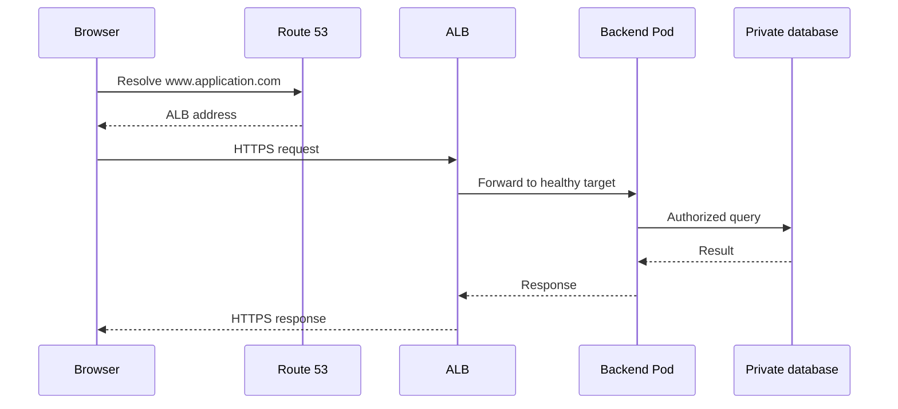
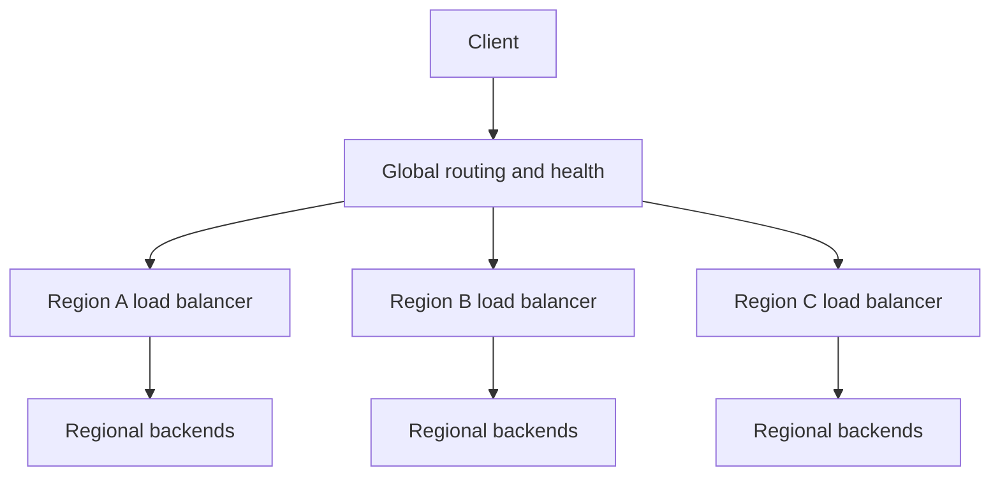

Complete guide with expanded examples: zs-associates-devops-interview-guide.md[zs-associates-devops-interview-guide.md](sandbox:/workspace/scratch/8dc6806ebb9b/zs-associates-devops-interview-guide.md).

**1. Multi-stage Docker builds: when are they useful? Are they suitable for compiled languages?**

Yes—compiled languages are a strong use case. Build the application with a compiler/SDK in one stage, then copy its output into a smaller runtime stage.

Examples:

- Go/Rust: Copy the executable.
- Java: Copy the JAR into a JRE image.
- C/C++: Copy the executable and required shared libraries.
- Frontend: Build JavaScript/CSS, then serve the output through a web server.

```dockerfile
# syntax=docker/dockerfile:1
FROM golang:1.26 AS build
WORKDIR /src

COPY go.mod go.sum ./
RUN go mod download

COPY . .
RUN CGO_ENABLED=0 go build -o /out/api ./cmd/api

FROM scratch
COPY --from=build /out/api /api
COPY --from=build /etc/ssl/certs/ca-certificates.crt /etc/ssl/certs/ca-certificates.crt
USER 10001:10001
ENTRYPOINT ["/api"]
```

This assumes the Go application works with CGO disabled. Build tools stay outside the final image, while CA certificates support outbound HTTPS. Pin production base images to approved digests. [Docker Docs](https://docs.docker.com/build/building/multi-stage/?utm_source=chatgpt.com)

**2. Explain layer caching with an example**

Docker/BuildKit can reuse build results when instructions and their relevant inputs remain unchanged.

In the previous example:

| Change | Expected effect |
|---|---|
| Application source changes | Dependency-download step can remain cached |
| `go.mod` or `go.sum` changes | Dependencies are downloaded again |
| Base image changes | Dependent build results are reconsidered |

Copy dependency manifests before frequently changing source files.

BuildKit cache mounts can additionally preserve downloaded dependencies between executions:

```dockerfile
RUN --mount=type=cache,target=/go/pkg/mod go mod download
```

Use `.dockerignore` to exclude irrelevant files and local secrets. Ephemeral CI runners need external cache export/import if their local cache disappears. [Docker Docs](https://docs.docker.com/build/cache/optimize/?utm_source=chatgpt.com)

**3. What is privileged mode in Docker?**

`--privileged` grants all Linux capabilities, broad device access, and relaxed security confinement. Running as root inside a normal container provides fewer permissions.

Example: a conventional Docker-in-Docker daemon on an isolated build runner:

```bash
docker run --rm --privileged docker:dind
```

Use dedicated, trusted infrastructure for this requirement. For narrower requirements, evaluate specific capabilities or devices. Rootless build alternatives can avoid privileged Docker-in-Docker for suitable workloads.

Privileged mode does not automatically enable host networking or the host PID namespace. [Docker Docs](https://docs.docker.com/engine/containers/run/?utm_source=chatgpt.com)

**4. Design an architecture so www.application.com reaches the backend**

For an EKS application:

- Route 53 resolves the hostname to an internet-facing ALB.
- ALB terminates HTTPS using an ACM certificate.
- Listener rules route requests to healthy backend targets.
- EKS Pods run on private nodes across AZs.
- Backend Pods access a private database using restricted permissions.



The AWS Load Balancer Controller watches Kubernetes configuration and programs ALB resources. It does not carry application requests.

With ALB IP targets, traffic can go directly to Pod IPs; the Service identifies the backend but its ClusterIP need not be traversed. Configure public-subnet discovery, controller IAM permissions, listener rules, certificates, health checks, and security groups. [AWS Load Balancer Controller](https://kubernetes-sigs.github.io/aws-load-balancer-controller/latest/guide/ingress/annotations/?utm_source=chatgpt.com)

**5. Calico versus Amazon VPC CNI: which would you prefer?**

Separate **networking/IP allocation** from **network-policy enforcement**.

| Configuration | Pod addressing | Policy enforcement |
|---|---|---|
| VPC CNI | VPC addresses through ENIs/prefixes | Supported AWS network-policy feature |
| Full Calico networking | Configured Calico IP pools and routing/overlay | Calico |
| VPC CNI with Calico policy | AWS still allocates VPC addresses | Calico |

For standard EKS, VPC CNI provides native AWS integration and directly routable VPC Pod addresses. Calico is useful when its networking or policy capabilities match the requirement.

Calico can provide policy without replacing VPC CNI. Its EKS guidance says not to enable AWS VPC CNI policy enforcement simultaneously with Calico policy enforcement. [Amazon EKS](https://docs.aws.amazon.com/eks/latest/userguide/managing-vpc-cni.html?utm_source=chatgpt.com)

Choose according to networking requirements, support, compatibility, address capacity, and operational complexity.

**6. How is a Pod IP allocated? Is its CIDR the same as the VPC CIDR?**

After scheduling, the node runtime invokes CNI to configure the Pod’s network namespace, interface, address, and routes.

With VPC CNI, `aws-node` maintains available addresses/prefixes on node ENIs.

- **Default networking:** Pod IPs normally come from the node’s subnet.
- **Custom networking:** Pod IPs can come from alternate subnets, including an associated secondary VPC CIDR.
- **Full Calico networking:** Pod addresses can come from separate configured Pod pools.
- **Calico policy with VPC CNI:** Address allocation remains AWS-managed. [Amazon EKS](https://docs.aws.amazon.com/eks/latest/userguide/managing-vpc-cni.html?utm_source=chatgpt.com)

Ordinary containers within one Pod share its IP. `hostNetwork` Pods share the node network namespace. Service ClusterIPs use a separate Service address range.

**7. Two Pods in the same ReplicaSet cannot communicate. Why?**

ReplicaSet membership does not override networking or application restrictions.

Check:

- Application listening on localhost instead of `0.0.0.0`.
- Wrong destination port.
- Source egress or destination ingress NetworkPolicy.
- CNI/routing failure.
- Security-group/NACL restrictions.
- DNS, Service selectors, or EndpointSlice problems.
- TLS or application authentication rejection.

```bash
kubectl -n app get pods -l app=backend -o wide
kubectl -n app get networkpolicy
kubectl -n app get svc backend -o yaml
kubectl -n app get endpointslices \
  -l kubernetes.io/service-name=backend
kubectl -n kube-system get pods -l k8s-app=aws-node -o wide
```

Test Pod IP/port separately from Service DNS using an approved debugging environment. If only cross-node communication fails, focus on CNI, routing, MTU, and network rules.

**8. How do you handle additional traffic to Pods?**

Use HPA to increase application replicas, and Karpenter/Cluster Autoscaler to provide node capacity.

```yaml
apiVersion: autoscaling/v2
kind: HorizontalPodAutoscaler
metadata:
  name: backend
  namespace: app
spec:
  scaleTargetRef:
    apiVersion: apps/v1
    kind: Deployment
    name: backend
  minReplicas: 3
  maxReplicas: 30
  metrics:
    - type: Resource
      resource:
        name: cpu
        target:
          type: Utilization
          averageUtilization: 65
  behavior:
    scaleDown:
      stabilizationWindowSeconds: 300
```

CPU utilization here is relative to CPU requests; configure requests and a working metrics API. Choose request rate, concurrency, or queue backlog when those better represent demand. [Kubernetes](https://kubernetes.io/docs/tasks/run-application/horizontal-pod-autoscale/?utm_source=chatgpt.com)

Also consider caching, queueing, bounded concurrency, and warm capacity. More Pods can worsen a database bottleneck, so check the complete system.

**9. HPA is configured, but some Pods remain Pending. Why?**

HPA changes replicas; it does not create compute capacity.

```bash
kubectl -n app describe pod PENDING_POD
kubectl -n app describe hpa backend
kubectl get nodepools,nodeclaims
```

Common causes:

- Insufficient requested CPU, memory, or ephemeral storage.
- Node Pod-count limits.
- Untolerated taints.
- Strict affinity/topology rules.
- PVC topology or attachment restrictions.
- Karpenter limits, IAM errors, EC2 quotas, or unavailable capacity.

Distinguish states: an IP-allocation failure after scheduling often appears as sandbox failure in `ContainerCreating`. ResourceQuota can prevent Pod creation entirely.

Fix the constraint shown in events rather than increasing replicas repeatedly.

**10. How would you provision Karpenter?**

Provide:

1. Supported, pinned controller and CRDs.
2. Stable capacity for the controller.
3. Controller IAM identity and scoped provisioning permissions.
4. Node IAM role/instance profile and cluster authentication.
5. Discoverable subnets/security groups, compatible AMIs, and available IPs.
6. NodePool and EC2NodeClass configuration.
7. Interruption handling, disruption controls, and monitoring.

Example configuration:

```yaml
apiVersion: karpenter.k8s.aws/v1
kind: EC2NodeClass
metadata:
  name: general
spec:
  amiFamily: AL2023
  amiSelectorTerms:
    - id: ami-REPLACE_WITH_TESTED_IMAGE
  role: KarpenterNodeRole-demo-eks
  subnetSelectorTerms:
    - tags:
        karpenter.sh/discovery: demo-eks
  securityGroupSelectorTerms:
    - tags:
        karpenter.sh/discovery: demo-eks
---
apiVersion: karpenter.sh/v1
kind: NodePool
metadata:
  name: general
spec:
  template:
    spec:
      nodeClassRef:
        group: karpenter.k8s.aws
        kind: EC2NodeClass
        name: general
      requirements:
        - key: kubernetes.io/arch
          operator: In
          values: [amd64]
        - key: kubernetes.io/os
          operator: In
          values: [linux]
        - key: karpenter.sh/capacity-type
          operator: In
          values: [on-demand, spot]
      expireAfter: 720h
  limits:
    cpu: "100"
    memory: 400Gi
  disruption:
    consolidationPolicy: WhenEmptyOrUnderutilized
    consolidateAfter: 5m
```

Replace the AMI with a tested regional image compatible with the cluster. Tag only the intended subnets/security groups.

For fully private clusters without IAM API connectivity, use a pre-created `instanceProfile` instead of `role`. These are alternatives, not fields to specify together. [Karpenter](https://karpenter.sh/docs/getting-started/getting-started-with-karpenter/?utm_source=chatgpt.com)

**11. Can MongoDB run on EKS? What configuration matters?**

Yes. Use a supported MongoDB operator managing StatefulSets and an actual MongoDB replica set. Three independent Pods do not automatically form a database replica set. [MongoDB Docs](https://www.mongodb.com/docs/kubernetes/current/?utm_source=chatgpt.com)

For a common three-member deployment, consider:

- Three data-bearing members spread across AZs/nodes.
- Separate persistent volumes per member.
- Encrypted EBS storage with measured IOPS/throughput.
- `WaitForFirstConsumer` storage binding.
- TLS, authentication, managed secrets, and restricted networking.
- Appropriate majority-durable writes.
- Memory/cache sizing, indexes, connections, and replication lag.
- Database-consistent backups and restore testing.
- Controlled upgrades and disruption policies.

A three-voter replica set needs a majority for elections. EBS volumes are AZ-scoped, so availability comes from surviving database members, not moving the failed disk across AZs. [MongoDB Docs](https://www.mongodb.com/docs/manual/core/replica-set-elections/?utm_source=chatgpt.com)

Evaluate managed MongoDB when it meets requirements and reduces operational ownership.

**12. Three backend Pods run in three regions. One fails—what happens?**

For EKS, model this as separate regional clusters behind global routing.



If healthy local replicas remain, the regional LB can use them. If the region’s only backend fails, Route 53 health-based routing or Global Accelerator can steer new traffic to healthy regions. A Kubernetes ReplicaSet is not a global deployment controller. [Amazon Route 53](https://docs.aws.amazon.com/Route53/latest/DeveloperGuide/routing-policy.html?utm_source=chatgpt.com)

Failover involves detection time, DNS caching, connection retries, session state, and spare capacity. Existing connections do not automatically migrate.

ALB also has a fail-open exception when all registered targets are unhealthy; global checks should measure application availability. [Elastic Load Balancing](https://docs.aws.amazon.com/elasticloadbalancing/latest/application/target-group-health-checks.html?utm_source=chatgpt.com)

**13. A load balancer does not accept HTTPS. What do you check?**

Identify whether the failure is DNS, TCP, TLS, listener routing, or the backend response.

```bash
curl -v --connect-timeout 5 --max-time 15 https://www.application.com/
openssl s_client \
  -connect www.application.com:443 \
  -servername www.application.com </dev/null
```

For ALB, check:

- HTTPS listener on 443.
- Usable certificate covering the hostname.
- Correct certificate region and TLS policy.
- Security-group/NACL access.
- Public routing when intended.
- Listener rules, target groups, and target health.
- Controller reconciliation if Kubernetes manages the LB. [Elastic Load Balancing](https://docs.aws.amazon.com/elasticloadbalancing/latest/application/load-balancer-listeners.html?utm_source=chatgpt.com)

If ALB terminates TLS and forwards HTTP, the Pod does not require its own certificate. Backend TLS is a separate choice.

**14. How can you redirect HTTP to HTTPS without installing a certificate?**

**Generating an HTTP redirect requires no certificate. Serving the destination HTTPS connection does.**

Configure listener 80 to return a redirect to HTTPS 443, preserving the hostname, path, and query. The HTTPS listener must have a suitable certificate. [Elastic Load Balancing](https://docs.aws.amazon.com/elasticloadbalancing/latest/application/rule-action-types.html?utm_source=chatgpt.com)

With ALB and ACM, you do not install the certificate inside each Pod. Alternatively, redirect to an endpoint where a managed edge already terminates TLS.

Changing the URL scheme alone cannot create a functioning secure endpoint.

**15. How does Karpenter know which node to provision?**

Karpenter observes unschedulable Pods through the Kubernetes API and combines their requirements with NodePool/NodeClass constraints.

It considers:

- Resource requests and DaemonSet/system overhead.
- Architecture and OS.
- Selectors, affinity, tolerations, and topology.
- Storage constraints.
- Allowed instance offerings, zones, capacity types, and limits.

It computes feasible capacity, creates NodeClaims, and launches nodes. The Kubernetes scheduler ultimately binds the Pods. [Karpenter](https://karpenter.sh/docs/concepts/scheduling/?utm_source=chatgpt.com)

**Example:** Pending Pods request 2 vCPU and 4 GiB each. Karpenter selects eligible capacity fitting those requests plus overhead.

CPU usage crossing 80% does not directly trigger this process. HPA may create replicas that become unschedulable, which then triggers provisioning.

**16. What causes CrashLoopBackOff?**

The container starts and repeatedly exits or is restarted.

Common causes:

- Application exceptions or invalid startup arguments.
- Missing/incorrect configuration.
- Permission errors.
- Dependency initialization failures.
- OOM kills.
- Aggressive startup/liveness probes.
- Incompatible binaries.
- A main process that exits instead of running continuously.

```bash
kubectl -n app describe pod backend-a
kubectl -n app logs backend-a -c backend --previous --tail=100
kubectl -n app get events --sort-by=.metadata.creationTimestamp
```

Readiness failure alone does not restart a container. `ImagePullBackOff` is a different failure. Exit code 137 alone does not establish OOM.

**17. A backend Pod needs S3 and Lambda access. How do you implement it?**

Associate a least-privilege IAM role with a dedicated ServiceAccount through **EKS Pod Identity or IRSA**. Use the SDK’s default credential chain instead of static keys or shared node credentials. [Amazon EKS](https://docs.aws.amazon.com/eks/latest/userguide/pod-identities.html?utm_source=chatgpt.com)

Example permissions:

```json
{
  "Version": "2012-10-17",
  "Statement": [
    {
      "Effect": "Allow",
      "Action": ["s3:GetObject", "s3:PutObject"],
      "Resource": "arn:aws:s3:::example-app-data/reports/*"
    },
    {
      "Effect": "Allow",
      "Action": "lambda:InvokeFunction",
      "Resource": "arn:aws:lambda:us-east-1:111122223333:function:process-report:live"
    }
  ]
}
```

Also provide service connectivity and applicable endpoint/resource policies. Add scoped KMS permissions when required.

The invoked Lambda uses its own execution role; it does not inherit the caller’s S3 permissions. An asynchronous invocation’s 202 response confirms acceptance, not successful execution. [AWS Lambda](https://docs.aws.amazon.com/lambda/latest/api/API_Invoke.html?utm_source=chatgpt.com)

**18. How does the ServiceAccount know which IAM role to assume?**

The configured identity integration and SDK perform the credential exchange.

| Mechanism | Role mapping | Requirements |
|---|---|---|
| IRSA | ServiceAccount annotation | IAM OIDC provider, role trust, projected token, supported SDK |
| Pod Identity | EKS association for cluster/namespace/ServiceAccount | Agent, role trust, association, supported SDK |

IRSA example:

```yaml
apiVersion: v1
kind: ServiceAccount
metadata:
  name: backend
  namespace: app
  annotations:
    eks.amazonaws.com/role-arn: arn:aws:iam::111122223333:role/backend-aws-access
```

The workload sets:

```yaml
spec:
  serviceAccountName: backend
```

IRSA trust matches the cluster OIDC provider, audience `sts.amazonaws.com`, and subject `system:serviceaccount:app:backend`. [Amazon EKS](https://docs.aws.amazon.com/eks/latest/userguide/associate-service-account-role.html?utm_source=chatgpt.com)

Pod Identity instead uses an EKS association:

```bash
aws eks create-pod-identity-association \
  --cluster-name demo-eks \
  --namespace app \
  --service-account backend \
  --role-arn arn:aws:iam::111122223333:role/backend-aws-access
```

Its trust uses `pods.eks.amazonaws.com`, `sts:AssumeRole`, and `sts:TagSession`. The IRSA annotation is unnecessary for this mechanism. Match the choice to supported compute and SDK versions. Kubernetes RBAC remains separate from AWS IAM. [Amazon EKS](https://docs.aws.amazon.com/eks/latest/userguide/pod-id-association.html?utm_source=chatgpt.com)

**19. Explain Ingress and Gateway API**

| Aspect | Ingress | Gateway API |
|---|---|---|
| Resources | IngressClass, Ingress | GatewayClass, Gateway, HTTPRoute and other routes |
| Ownership | Mainly application routing | Separates infrastructure/listeners from application routes |
| Advanced features | Often annotations | Richer standardized routing where supported |
| Cross-namespace use | Limited core model | Explicit attachment and reference authorization |
| Evolution | Stable, frozen API | New capabilities developed here |

Both require an implementation/controller. Gateway API alone is not a global multi-region router. [Kubernetes](https://kubernetes.io/docs/concepts/services-networking/ingress/?utm_source=chatgpt.com)

Example HTTPRoute, assuming an existing Gateway permits attachment:

```yaml
apiVersion: gateway.networking.k8s.io/v1
kind: HTTPRoute
metadata:
  name: backend
  namespace: app
spec:
  parentRefs:
    - name: public
      namespace: infra
      sectionName: https
  hostnames: [www.application.com]
  rules:
    - matches:
        - path:
            type: PathPrefix
            value: /api
      backendRefs:
        - name: backend
          port: 80
```

Check controller conformance and support. Cross-namespace backend references require the applicable ReferenceGrant.

**20. A ReplicaSet wants three Pods, but one does not come up. Why?**

First establish whether the third Pod exists.

```bash
kubectl -n app describe rs REPLICA_SET_NAME
kubectl -n app get pods -l app=backend -o wide
kubectl -n app describe pod FAILED_POD
```

| Observation | Likely investigation |
|---|---|
| Pod not created | Quota, admission rejection, invalid specification |
| Pending | Capacity, taints, affinity, topology, PVC constraints |
| ContainerCreating | CNI, volume attachment/mount, node problems |
| ImagePullBackOff | Image, registry credentials/connectivity |
| CrashLoopBackOff | Application termination, probes, resource pressure |
| Running but not Ready | Readiness, startup, configuration, dependencies |

**Example:** Required anti-affinity with only two eligible nodes prevents the third replica from scheduling.

Fix the constraint instead of repeatedly deleting Pods.

**21. Explain Argo CD, your CI/CD, and cluster/node counts**

Use this as an experience template:

> “Our CI runs tests and security checks, builds/scans the container, and publishes an immutable digest. Promotion updates reviewed environment configuration in Git. Argo CD compares that configuration with the cluster and reconciles according to policy. Environment validation and approvals control promotion.”

Argo CD provides GitOps delivery and drift visibility; it does not replace building and testing. Rollback should restore the correct desired state so reconciliation retains it. [argo-cd.readthedocs.io](https://argo-cd.readthedocs.io/en/stable/?utm_source=chatgpt.com)

For scale, supply actual figures:

> “We operate [N] clusters across [accounts/environments/regions], with [baseline] system nodes and workload capacity ranging from [minimum] to [maximum].”

Explain why environments are separated and what you personally own.

**22. How do you implement Terraform state locking?**

Use a remote backend supporting locking. Current S3 backends support native lockfiles; DynamoDB locking is deprecated.

```hcl
terraform {
  required_version = ">= 1.10.0"

  backend "s3" {
    bucket       = "example-org-terraform-state"
    key          = "dev/us-east-1/platform.tfstate"
    region       = "us-east-1"
    encrypt      = true
    use_lockfile = true
  }
}
```

```bash
terraform init
terraform plan -lock-timeout=5m -out=tfplan
terraform apply tfplan
```

Provide state/lockfile permissions, restricted access, versioning, and encryption. The `.tflock` object requires Get/Put/Delete permissions. [HashiCorp Developer](https://developer.hashicorp.com/terraform/language/backend/s3?utm_source=chatgpt.com)

A lock protects one state, not every resource in the account. Use `force-unlock` only after confirming the owning operation has stopped.

**23. Explain Terraform for_each with an example**

`for_each` creates instances identified by stable map keys or set members.

```hcl
variable "buckets" {
  type = map(string)
}

resource "aws_s3_bucket" "logs" {
  for_each = var.buckets
  bucket   = each.value
  tags     = { Purpose = each.key }
}
```

Example input:

```hcl
buckets = {
  application = "example-company-dev-app-logs-123456789012"
  audit       = "example-company-dev-audit-logs-123456789012"
}
```

Addresses become:

```text
aws_s3_bucket.logs["application"]
aws_s3_bucket.logs["audit"]
```

Adding a key adds an instance; removing it proposes deletion. Renaming keys changes identity unless migrated. Keys must be known before apply and cannot be sensitive. [HashiCorp Developer](https://developer.hashicorp.com/terraform/language/meta-arguments/for_each?utm_source=chatgpt.com)

**24. How would Terraform deploy EC2 in three regions?**

Configure regional provider aliases and pass each into the same reusable module.

Root-module excerpt:

```hcl
provider "aws" {
  alias  = "east"
  region = "us-east-1"
}

provider "aws" {
  alias  = "west"
  region = "us-west-2"
}

provider "aws" {
  alias  = "europe"
  region = "eu-west-1"
}

module "api_east" {
  source    = "./modules/ec2"
  providers = { aws = aws.east }
  name      = "api-east"
  config    = var.regional_config["east"]
}

module "api_west" {
  source    = "./modules/ec2"
  providers = { aws = aws.west }
  name      = "api-west"
  config    = var.regional_config["west"]
}

module "api_europe" {
  source    = "./modules/ec2"
  providers = { aws = aws.europe }
  name      = "api-europe"
  config    = var.regional_config["europe"]
}
```

Each regional configuration supplies its own AMI, subnet, security groups, and instance type. The child declares provider requirements and receives the configured provider.

Ordinary Terraform provider references are static; do not assume `aws[each.key]` dynamically selects aliases. Separate regional root states often provide better operational independence. [HashiCorp Developer](https://developer.hashicorp.com/terraform/language/modules/develop/providers?utm_source=chatgpt.com)

**25. What should you explain about Terraform modules?**

A module is a reusable directory of Terraform configuration.

Explain:

- Inputs define its contract.
- Resources implement behavior.
- Outputs expose results to callers.
- Providers are configured in the root and passed where needed.
- Backends belong to root configurations.
- A child normally shares its caller’s state.
- Module versions/refs and provider versions should be controlled.
- Upgrades require changelog review, planning, and validation.

Registry modules use version constraints; Git sources use an appropriate `?ref=`. Files such as `main.tf`, `variables.tf`, and `outputs.tf` are conventions, not execution ordering.

**26. A module change should update a resource without recreating it. What do you do?**

Inspect why the plan proposes replacement.

| Cause | Approach |
|---|---|
| Mutable attribute | Supported in-place update |
| Resource-address refactor | `moved` block or controlled state migration |
| Immutable attribute | Retain the old value, reject the change, or plan replacement |

Address migration:

```hcl
moved {
  from = aws_instance.api
  to   = module.compute.aws_instance.this
}
```

This preserves address identity, but cannot suppress an unrelated replacement-causing change. [HashiCorp Developer](https://developer.hashicorp.com/terraform/language/modules/develop/refactoring?utm_source=chatgpt.com)

Protection inside the resource:

```hcl
lifecycle {
  prevent_destroy = true
}
```

`prevent_destroy` rejects destruction while its configuration exists. It does not make immutable attributes mutable. `create_before_destroy` still performs replacement; `ignore_changes` deliberately stops managing selected changes. [HashiCorp Developer](https://developer.hashicorp.com/terraform/language/meta-arguments/lifecycle?utm_source=chatgpt.com)

Review and gate the plan. In-place changes can still cause downtime—for example, an EC2 update requiring stop/start.

**27. What would a reusable EKS module structure look like?**

| File/path | Purpose |
|---|---|
| `modules/eks/versions.tf` | Terraform/provider compatibility |
| `variables.tf` | Validated cluster, networking, role and node inputs |
| `cluster.tf` | Control plane, endpoints, logging |
| `node_groups.tf` | Managed groups and update settings |
| `access.tf` | Access entries and authorization |
| `addons.tf` | Compatible add-ons and identities |
| `outputs.tf` | Cluster name, endpoint, CA and identifiers |
| `README.md` | Contract, prerequisites and upgrade guidance |
| Environment root directories | Independent backend/provider/module configuration |

Core cluster example:

```hcl
resource "aws_eks_cluster" "this" {
  name     = var.cluster_name
  role_arn = var.cluster_role_arn
  version  = var.kubernetes_version

  enabled_cluster_log_types = [
    "api", "audit", "authenticator", "controllerManager", "scheduler"
  ]

  access_config {
    authentication_mode                         = "API"
    bootstrap_cluster_creator_admin_permissions = false
  }

  vpc_config {
    subnet_ids              = var.private_subnet_ids
    endpoint_private_access = true
    endpoint_public_access  = false
  }
}
```

The role and networking must already be correctly provisioned, and explicit administrative access must be configured because creator access is disabled. Operators need private endpoint connectivity. [GitHub](https://github.com/hashicorp/terraform-provider-aws/blob/main/website/docs/r/eks_cluster.html.markdown?utm_source=chatgpt.com)

Add node groups, scoped team access, CNI/DNS/CSI/identity add-ons, encryption controls, autoscaling, observability, and upgrade validation. With Karpenter, maintain stable system capacity and define workload capacity through NodePools.

The guide includes fuller module code. Its YAML/JSON, shell, and Python examples were syntax-checked; Terraform snippets received manual review because Terraform is unavailable here.
