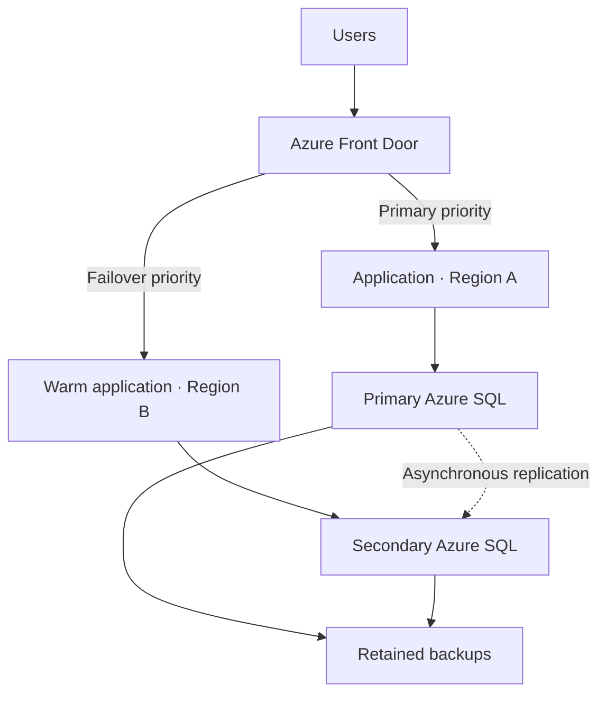
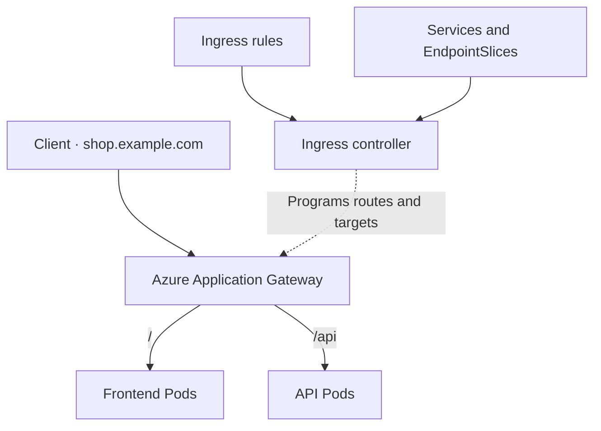

Below are answers to all **19 Zensar questions**, with practical examples and architecture diagrams. A downloadable guide is linked at the end.

**1. What is a service connection? What is a connection string?**

These serve different purposes:

| Aspect | Service connection | Connection string |
|---|---|---|
| Purpose | Allows a pipeline to authenticate to an external platform | Allows an application to connect to a dependency |
| Used by | Azure Pipeline tasks | Application code or database clients |
| Example | Azure Resource Manager connection | SQL database connection settings |
| Configuration | Target endpoint, identity, authentication method | Server, database, authentication and connection options |

For Azure deployments, create a service connection under **Project settings → Service connections**. Prefer **workload identity federation**, which obtains temporary tokens without storing a long-lived client secret. Authorize the required pipelines and grant the identity permissions only at the necessary Azure scope. [Microsoft Learn](https://learn.microsoft.com/en-us/azure/devops/pipelines/library/service-endpoints?view=azure-devops\&utm_source=chatgpt.com)

Example task:

```yaml
steps:
- task: AzureCLI@2
  inputs:
    azureSubscription: sc-dev-wif
    scriptType: bash
    scriptLocation: inlineScript
    inlineScript: |
      az group show --name rg-app-dev --query name --output tsv
```

Here, `azureSubscription` contains the **service connection name**.

A passwordless SQL connection string could be:

```text
Server=tcp:orders.database.windows.net,1433;Database=orders;
Authentication=Active Directory Managed Identity;Encrypt=True;
```

This requires a compatible SQL client and an application managed identity authorized in the database. The pipeline’s deployment identity and the application’s runtime identity are configured separately. [Microsoft Learn](https://learn.microsoft.com/en-us/sql/connect/ado-net/sql/azure-active-directory-authentication?view=sql-server-ver17\&utm_source=chatgpt.com)

---

**2. How do you configure alerts in Azure Monitor?**

An alert consists of **scope + condition + action group**.

Example: notify the operations team when a VM’s five-minute average CPU exceeds 80%.

| Configuration | Example |
|---|---|
| Scope | Production VM |
| Signal | Percentage CPU |
| Aggregation | Average |
| Threshold | Greater than 80% |
| Lookback window | Five minutes |
| Evaluation frequency | One minute |
| Severity | Sev 2, according to the team’s policy |
| Action group | On-call notifications and incident integration |
| Resolution | Automatically resolve when healthy |

Steps:

1. Open **Azure Monitor → Alerts → Create → Alert rule**.
2. Select the subscription and monitored resource.
3. Select the signal and configure threshold, aggregation, evaluation frequency and dimensions.
4. Attach an action group.
5. Set the rule name, severity and resolution behavior.
6. Create the rule and test both notification delivery and recovery behavior. [Microsoft Learn](https://learn.microsoft.com/en-us/azure/azure-monitor/alerts/alerts-create-new-alert-rule?utm_source=chatgpt.com)

A five-minute **average** above 80% does not mean every sample was above 80%.

VM platform CPU is available without a guest agent. Guest memory and filesystem usage require appropriate collection, commonly **Azure Monitor Agent with a Data Collection Rule**, followed by an alert against the collected metrics or logs. For applications, also monitor availability, errors and latency. [Microsoft Learn](https://learn.microsoft.com/en-us/azure/azure-monitor/agents/azure-monitor-agent-overview?utm_source=chatgpt.com)

---

**3. What are the types of VNet peering?**

| Type | Description | Example |
|---|---|---|
| Regional/local peering | Connects VNets in the same region | Application and shared-services VNets in Central India |
| Global peering | Connects VNets in different regions | Central India and West Europe VNets |

Peering traffic uses Microsoft’s backbone. VNets can belong to different subscriptions or tenants, subject to permissions and configuration. [Microsoft Learn](https://learn.microsoft.com/en-us/azure/virtual-network/virtual-network-peering-overview?utm_source=chatgpt.com)

Important points:

- Ordinary VNet peering requires non-overlapping address spaces.
- Both directions must be configured and show **Connected**.
- Peering is **non-transitive**: A–B and B–C do not automatically establish A–C connectivity.
- NSGs, firewalls, routing and DNS must still permit the intended communication.
- **Gateway transit** lets a spoke use a supported hub gateway; it is a peering feature.

For spoke-to-spoke communication, use direct peering or an explicitly configured hub routing design. [Microsoft Learn](https://learn.microsoft.com/en-us/azure/virtual-network/virtual-network-manage-peering?utm_source=chatgpt.com)

---

**4. What is DR?**

**Disaster recovery** is the planned restoration of a service after a major failure, such as a regional outage, destructive change or data corruption.

Two business requirements drive the design:

| Term | Meaning | Example |
|---|---|---|
| RTO | Maximum acceptable recovery time | Restore service within 30 minutes |
| RPO | Maximum acceptable lost data, measured in time | Lose at most five minutes of transactions |

These are targets that must be supported by the architecture and tested recovery procedures. [Microsoft Learn](https://learn.microsoft.com/en-us/azure/architecture/framework/resiliency/business-metrics?utm_source=chatgpt.com)

Example Azure architecture:



Front Door provides global application routing, while an Azure SQL failover group supplies database replication and listener endpoints. Applications must handle interrupted connections and reconnect after failover. [Microsoft Learn](https://learn.microsoft.com/en-us/azure/frontdoor/front-door-overview?utm_source=chatgpt.com)

The recovery runbook covers database promotion, application readiness, traffic switching, validation and failback. Include certificates, secrets, images, networking and other dependencies.

**Forced failover with asynchronous replication can lose recent writes.** Replicas also propagate logical mistakes, so backups and tested restores remain necessary.

---

**5. What types of pipelines are there? Which would you use?**

Azure Pipelines has two main **authoring approaches**:

| Approach | Description |
|---|---|
| YAML | Pipeline configuration stored and reviewed in Git |
| Classic | Pipeline configuration created through the visual editor |

Classic includes build and release pipelines. YAML can combine build, testing and deployment in a multistage pipeline. [Microsoft Learn](https://learn.microsoft.com/en-us/azure/devops/pipelines/get-started/pipelines-get-started?view=azure-devops\&utm_source=chatgpt.com)

By purpose, pipelines are also described as:

- **CI/build:** compile, test, scan and publish an artifact.
- **CD/release:** deploy an existing artifact.
- **Multistage:** combine these activities with environment promotion.

A suitable interview answer is:

> “For a new project, I would use reusable multistage YAML templates. I would build the artifact once, then promote the same version through Dev, QA and Production, with validation and production approvals.”

The hierarchy is **pipeline → stages → jobs → steps**. Agent jobs execute on workers; server jobs support selected orchestration tasks; deployment jobs add environment-oriented deployment behavior. [Microsoft Learn](https://learn.microsoft.com/en-us/azure/devops/pipelines/process/phases?view=azure-devops\&utm_source=chatgpt.com)

---

**6. What is a pipeline variable?**

A pipeline variable supplies configuration such as the environment, resource group, image tag or secret reference.

Azure Pipeline variables are generally **strings**. Parameters can be typed and are expanded while the pipeline is prepared.

| Syntax | Purpose |
|---|---|
| `$(imageTag)` | Macro expansion before a task runs |
| `${{ parameters.environment }}` | Template expansion |
| `$[dependencies.Build.outputs['publish.imageTag']]` | Read a named upstream output at runtime |

Example:

```yaml
parameters:
- name: environment
  type: string
  default: dev
  values: [dev, qa, prod]

variables:
- group: shared-ci
- name: targetEnvironment
  value: ${{ parameters.environment }}
- name: imageTag
  value: $(Build.BuildId)

steps:
- bash: ./ci/deploy.sh "$TARGET_ENV" "$IMAGE_TAG"
  env:
    TARGET_ENV: $(targetEnvironment)
    IMAGE_TAG: $(imageTag)
    DEPLOYMENT_TOKEN: $(deploymentToken)
```

This assumes the repository contains `ci/deploy.sh` and the authorized variable group contains the secret `deploymentToken`.

Map secrets to task environment variables and never print them. Use named output variables to pass results between jobs; a shell `export` does not persist across jobs. Protect Production through permissions and environment checks—an environment parameter alone is insufficient. [Microsoft Learn](https://learn.microsoft.com/en-us/azure/devops/pipelines/process/variables?view=azure-devops\&utm_source=chatgpt.com)

---

**7. Can multiple jobs run in parallel within one pipeline?**

**Yes.** Independent jobs can run concurrently. A dependent job waits for its prerequisites.

Example for a Python repository containing `src/`, `tests/`, `requirements-dev.txt` and a Dockerfile:

```yaml
trigger:
- main

pool:
  vmImage: ubuntu-latest

jobs:
- job: UnitTests
  dependsOn: []
  steps:
  - bash: |
      set -euo pipefail
      python3 -m pip install -r requirements-dev.txt
      python3 -m unittest discover -s tests -v

- job: SyntaxCheck
  dependsOn: []
  steps:
  - bash: python3 -m compileall -q src/

- job: ContainerBuild
  dependsOn: [UnitTests, SyntaxCheck]
  steps:
  - bash: docker build -t sample-app:$(Build.BuildId) .
```

`UnitTests` and `SyntaxCheck` can run together. `ContainerBuild` starts after both succeed. Steps inside a job normally execute sequentially. [Microsoft Learn](https://learn.microsoft.com/en-us/azure/devops/pipelines/process/phases?view=azure-devops\&utm_source=chatgpt.com)

Actual concurrency requires:

- Available agents.
- Sufficient **organization-level parallel-job capacity**.

With one parallel-job slot, eligible jobs queue even if multiple agents are registered. Matrix strategies can create additional job variants, with `maxParallel` limiting their concurrency. [Microsoft Learn](https://learn.microsoft.com/en-us/azure/devops/pipelines/licensing/concurrent-jobs?view=azure-devops\&utm_source=chatgpt.com)

---

**8. What is an agent?**

An agent is the worker software that executes pipeline jobs on a VM, physical machine or container.

| Type | Characteristics |
|---|---|
| Microsoft-hosted | Microsoft maintains the image; each job gets a fresh VM that is discarded afterward |
| Self-hosted | Your team manages tools, patching, capacity, network access and workspace hygiene |

Azure DevOps queues the job, selects an eligible agent from the requested pool, and dispatches the work. The agent checks out code, executes tasks and uploads logs/results.

Self-hosted agents are useful for private AKS endpoints, private package feeds or specialized build tools. Persistent workspaces can improve speed but retain stale files or sensitive material.

For privileged deployments, use isolated workers and keep untrusted PR builds away from production credentials. Each agent normally runs one job at a time, subject to the organization’s concurrency entitlement. [Microsoft Learn](https://learn.microsoft.com/en-us/azure/devops/pipelines/agents/agents?view=azure-devops\&utm_source=chatgpt.com)

---

**9. ReplicaSet versus Deployment**

| Feature | ReplicaSet | Deployment |
|---|---|---|
| Responsibility | Maintain the desired number of matching Pods | Manage ReplicaSets and application rollouts |
| Replace failed Pods | Yes | Through ReplicaSets |
| Rolling application updates | No built-in rollout orchestration | Supported |
| Revision history and rollback | No Deployment history | Supported |
| Typical usage | Managed indirectly | Normal choice for stateless applications |

With three replicas, a ReplicaSet replaces a deleted Pod.

When a Deployment’s Pod template changes from `api:v1` to `api:v2`, it creates a new ReplicaSet and shifts replicas according to its update strategy. Changing a standalone ReplicaSet template does not automatically update its existing Pods.

```bash
kubectl set image deployment/api api=registry.example.com/api:v2
kubectl rollout status deployment/api
kubectl rollout undo deployment/api
```

Rollback uses retained Deployment/ReplicaSet revision information. It does not discover the previous image by searching the registry. The previous image must remain available, and database changes need their own compatibility plan. [Kubernetes](https://kubernetes.io/docs/concepts/workloads/controllers/deployment/?utm_source=chatgpt.com)

---

**10. Stateless versus stateful applications**

| Aspect | Stateless | Stateful |
|---|---|---|
| Durable instance-local state | Not required for correct request processing | Must preserve or coordinate state |
| Interchangeability | Instances are usually interchangeable | Instances may need stable identities and data |
| Example | API using an external database | Database replica with durable storage |
| Kubernetes pattern | Deployment | Often StatefulSet plus suitable storage/operator |

An API can create orders in a database and still be stateless because durable state lives outside the API process.

If sessions exist only in one Pod’s memory, replacing that Pod loses them. Moving sessions to a shared store allows interchangeable API instances.

A StatefulSet provides stable identities and can create a PVC per replica. It does **not** automatically configure database replication, quorum, backups or safe failover. Those require database-specific design and operation. [Kubernetes](https://kubernetes.io/docs/concepts/workloads/controllers/statefulset/?utm_source=chatgpt.com)

---

**11. How can ConfigMaps and Secrets be used?**

- **ConfigMap:** non-sensitive configuration, such as log level or timeout.
- **Secret:** sensitive values, such as passwords or TLS keys.

Both can be consumed through environment variables or mounted files.

Create a Secret from a securely supplied file:

```bash
kubectl create namespace demo
kubectl -n demo create secret generic db-credentials \
  --from-file=password=/secure/db-password
```

Example configuration:

```yaml
apiVersion: v1
kind: ConfigMap
metadata:
  name: app-config
  namespace: demo
data:
  LOG_LEVEL: info
  app.yaml: |
    timeoutSeconds: 10
---
apiVersion: v1
kind: Pod
metadata:
  name: config-example
  namespace: demo
spec:
  containers:
  - name: app
    image: registry.example.com/team/app:1.0.0
    env:
    - name: LOG_LEVEL
      valueFrom:
        configMapKeyRef:
          name: app-config
          key: LOG_LEVEL
    - name: DB_PASSWORD
      valueFrom:
        secretKeyRef:
          name: db-credentials
          key: password
    volumeMounts:
    - name: settings
      mountPath: /etc/app
      readOnly: true
  volumes:
  - name: settings
    configMap:
      name: app-config
```

Replace the image with an application that reads these settings.

Environment values require a container restart to refresh. Ordinary mounted ConfigMap/Secret files update eventually, but the application must reload them; `subPath` mounts do not receive those updates. [Kubernetes](https://kubernetes.io/docs/concepts/configuration/configmap/?utm_source=chatgpt.com)

Secret base64 encoding is **not encryption**. Restrict access with RBAC and verify encryption at rest. On AKS, Key Vault integration through the Secrets Store CSI driver and workload identity is a common alternative to storing secret values in deployment manifests. [Microsoft Learn](https://learn.microsoft.com/en-us/azure/aks/csi-secrets-store-driver?utm_source=chatgpt.com)

---

**12. If the control plane goes down, what happens to workers?**

Workload execution happens on workers through kubelet and the container runtime. The practical consequence is that **existing containers usually keep running** during a control-plane outage, while cluster management and reconciliation are impaired. [Kubernetes](https://kubernetes.io/docs/concepts/overview/components/?utm_source=chatgpt.com)

| Failure | Expected impact |
|---|---|
| One control-plane instance in a healthy HA setup | Remaining components continue if API availability and etcd quorum remain |
| Complete control-plane/API outage | Existing workloads may continue; scheduling and reconciliation cannot operate normally |
| Worker failure during that outage | Its workloads cannot be rescheduled elsewhere until control-plane operation recovers |

New deployments, HPA decisions and endpoint reconciliation are affected. Kubelet may restart an existing container locally, but it cannot perform cluster-wide rescheduling.

Application availability can deteriorate as endpoints change, credentials expire or dependencies require API access.

For troubleshooting, first distinguish an actual control-plane outage from a private endpoint, DNS, firewall or authentication problem. In AKS, investigate provider health and cluster diagnostics while checking application health independently.

---

**13. What is etcd, and what is its use?**

**etcd is a distributed, strongly consistent key-value store.** Kubernetes uses it to persist API object data, including desired configuration and recorded cluster state.

Examples include Deployments, Services, Secrets, RBAC objects, Pod records and leases. Container images and application persistent-volume files are stored elsewhere.

The API server normally accesses this datastore; controllers and schedulers work through the Kubernetes API. [Kubernetes](https://kubernetes.io/docs/concepts/overview/components/?utm_source=chatgpt.com)

etcd uses **Raft consensus**, requiring a majority of voting members:

| Members | Quorum | Failures tolerated |
|---|---|---|
| 3 | 2 | 1 |
| 5 | 3 | 2 |

For self-managed clusters, use fast disks, low inter-member latency, restricted access, TLS and tested snapshots/restores.

An etcd backup protects cluster metadata. It does not replace application database or persistent-volume backups. Azure operates the managed control plane in AKS, while application recovery remains part of your operational design. [etcd](https://etcd.io/docs/v3.6/faq/?utm_source=chatgpt.com)

---

**14. How do you create an app registration?**

An app registration defines an application’s identity and authentication configuration in **Microsoft Entra ID**.

Steps:

1. Open **Entra admin center → App registrations → New registration**.
2. Enter a name and select supported account types.
3. Add a redirect URI if required by the application’s sign-in flow.
4. Register the application.
5. Record its **application/client ID** and **directory/tenant ID**.
6. Configure required API permissions and consent.
7. For a pipeline identity, configure federation using the actual service connection’s issuer, subject and audience.
8. Assign the app’s service principal appropriate Azure RBAC at the required scope.
9. Test authentication and the required operations. [Microsoft Learn](https://learn.microsoft.com/en-us/entra/identity-platform/quickstart-register-app?utm_source=chatgpt.com)

The **application object** is the definition. The **service principal** is its identity in a tenant.

Registration alone does not grant Azure subscription access. API permissions and Azure resource RBAC are separate. Prefer federation or managed identity where supported; securely store and rotate any unavoidable client secret.

---

**15. What is Docker networking?**

Docker networking controls container communication with other containers, the host and external systems.

| Driver | Use |
|---|---|
| `bridge` | Containers on one host |
| `host` | Share the host networking stack where supported |
| `none` | No external networking; loopback remains |
| `overlay` | Multi-host communication using Docker Swarm infrastructure |
| `macvlan` | Give containers separate MAC addresses on the external network |
| `ipvlan` | Expose container networking without requiring a separate MAC per container |

These drivers address different connectivity and isolation requirements. [Docker Docs](https://docs.docker.com/engine/network/drivers/?utm_source=chatgpt.com)

Example:

```bash
docker network create app-net

docker run -d --name web --network app-net \
  -p 127.0.0.1:8080:80 nginx:alpine

docker run --rm --network app-net \
  curlimages/curl http://web:80
```

The client resolves `web` through Docker DNS on the user-defined network. The published port exposes the server on the host at `127.0.0.1:8080`.

A container’s `localhost` normally refers to itself. Publishing a host port and allowing communication between containers are separate operations. [Docker Docs](https://docs.docker.com/engine/network/drivers/bridge/?utm_source=chatgpt.com)

---

**16. Why is Kubernetes needed if Docker volumes exist?**

Docker volumes provide **persistence**. Kubernetes provides **orchestration across a cluster**.

| Requirement | Capability |
|---|---|
| Preserve files after container replacement | Docker volume or Kubernetes persistent storage |
| Schedule workloads across nodes | Kubernetes scheduler |
| Maintain replicas | Workload controllers |
| Discover and route to workloads | Services and networking components |
| Perform controlled updates | Deployments |
| Scale applications | Autoscaling |
| Provision supported storage | PVCs, StorageClasses and CSI drivers |

A local Docker volume can preserve database files when a container is recreated on the same host. It does not by itself make the database recoverable when that host is lost. [Docker Docs](https://docs.docker.com/engine/storage/volumes/?utm_source=chatgpt.com)

Kubernetes can recreate workloads on another node, but their data must also be accessible and recoverable there. A PVC does **not** automatically replicate database contents.

Docker Compose can be sufficient for a small single-host application. Kubernetes becomes useful when scheduling, availability, scaling and policy requirements justify its operational complexity.

---

**17. How can Pods in different namespaces communicate securely?**

Use:

- A **Service** for discovery.
- **NetworkPolicy** to restrict permitted connections.
- **TLS and authentication/authorization** to protect application requests.

Assume `app: web` Pods in `frontend` call `app: api` Pods in `backend`, where the API listens on TLS port 8443.

With the default cluster DNS suffix, a Service named `api` is discoverable as:

```text
api.backend.svc.cluster.local
```

Restrict backend ingress:

```yaml
apiVersion: networking.k8s.io/v1
kind: NetworkPolicy
metadata:
  name: api-from-frontend
  namespace: backend
spec:
  podSelector:
    matchLabels:
      app: api
  policyTypes: [Ingress]
  ingress:
  - from:
    - namespaceSelector:
        matchLabels:
          kubernetes.io/metadata.name: frontend
      podSelector:
        matchLabels:
          app: web
    ports:
    - protocol: TCP
      port: 8443
```

The namespace and Pod selectors share one source item, so **both must match**. Separate items would mean OR.

If frontend egress is restricted, allow the API destination and the actual DNS resolver on UDP/TCP 53. Policies are additive, so audit other policies for broader allowances. [Kubernetes](https://kubernetes.io/docs/concepts/services-networking/network-policies/?utm_source=chatgpt.com)

The cluster needs a policy-enforcing implementation, such as a supported Azure CNI Powered by Cilium configuration. NetworkPolicy filters traffic; application TLS/mTLS and authorization provide encryption and caller identity. Protect policy changes and labels through RBAC/admission controls. [Microsoft Learn](https://learn.microsoft.com/en-us/azure/aks/use-network-policies?utm_source=chatgpt.com)

---

**18. What is Ingress?**

An **Ingress** is a Kubernetes resource describing HTTP/HTTPS routing to Services, usually using hostnames and paths.

An **Ingress controller** implements those rules. Creating an Ingress without a compatible controller does not establish request routing. [Kubernetes](https://kubernetes.io/docs/concepts/services-networking/ingress/?utm_source=chatgpt.com)

Example AKS architecture using Application Gateway Ingress Controller:



For example:

- `shop.example.com/` routes to the frontend.
- `shop.example.com/api` routes to the API.

The controller watches Kubernetes configuration and programs Application Gateway. **Application Gateway sends traffic directly to selected Pod IPs** in this design; the Service’s ClusterIP is not a mandatory intermediate hop. The controller handles configuration, while the gateway carries application traffic. [Microsoft Learn](https://learn.microsoft.com/en-us/azure/application-gateway/ingress-controller-overview?utm_source=chatgpt.com)

Configure the correct IngressClass, DNS, certificates, backend ports, health checks and access restrictions. Ingress remains supported, while Gateway API provides newer routing capabilities where supported.

---

**19. For cost optimization, should we use Application Gateway or a network gateway?**

First establish what “network gateway” means. Azure Load Balancer and VPN Gateway solve different problems.

| Service | Purpose | Choose when |
|---|---|---|
| **Application Gateway** | Regional L7 HTTP/HTTPS balancing, host/path routing, TLS termination and WAF with an appropriate SKU | Managed web routing/security features are required |
| **Azure Load Balancer** | L4 TCP/UDP load balancing | Transport-level balancing is sufficient |
| **VPN Gateway** | Encrypted connectivity between networks | On-premises or other supported VPN connectivity is required |

These products are not interchangeable. [Microsoft Learn](https://learn.microsoft.com/en-us/azure/application-gateway/overview?utm_source=chatgpt.com)

For simple TCP balancing, Load Balancer can be the economical fit. For multiple HTTPS applications needing managed host/path routing and WAF, Application Gateway can be justified.

If an AKS ingress layer supplies equivalent capabilities behind a Load Balancer, include its compute, scaling, security tooling, certificate management and operational costs.

Estimate using the actual **region, SKU, capacity, rules, processed traffic, data transfer and availability requirements**. Avoid assuming a universal price or selecting a cheaper service that does not meet the application’s requirements. [Microsoft Azure](https://azure.microsoft.com/en-us/pricing/details/application-gateway/?utm_source=chatgpt.com)

:chatgpt-content-reference{index="32"}[zensar-devops-interview-guide.md](sandbox:/workspace/scratch/8dc6806ebb9b/zensar-devops-interview-guide.md)
