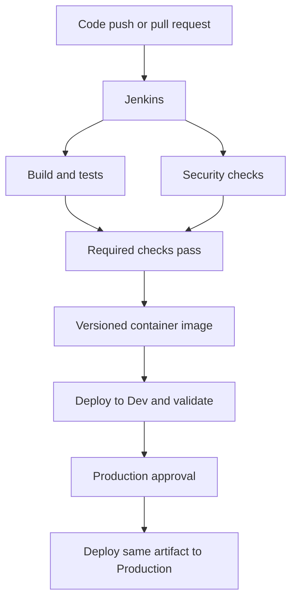

These answers are suited to a **two-year DevOps role**, with examples you can explain during an interview.

**1. Explain a CI/CD pipeline**

CI/CD automates building, testing and releasing an application.

- **Continuous integration:** integrate code changes regularly, then build and test them.
- **Continuous delivery:** keep validated releases ready for deployment, with approval where required.
- **Continuous deployment:** automatically deploy eligible changes after all required checks pass.

A typical workflow:



For example, Jenkins checks out a Java application, builds it with Maven, runs tests, builds and scans its Docker image, publishes it, and deploys it to Kubernetes.

A failed required check prevents deployment. Promote the same tested artifact between environments and verify application health after deployment. [jenkins.io](https://www.jenkins.io/doc/book/pipeline/?utm_source=chatgpt.com)

---

**2. Write a declarative Jenkins pipeline**

This example builds a Java application, pushes its image to Docker Hub, and updates an existing Kubernetes Dev deployment.

Assumptions:

- A **Multibranch Pipeline** reads this `Jenkinsfile`.
- Agent `linux-docker` has Git, JDK 21, Maven, Docker and kubectl.
- Maven produces an executable `target/app.jar`.
- Jenkins stores credentials `dockerhub-creds` and Secret file `dev-kubeconfig`.
- Deployment `demo-app` exists in namespace `dev`, with container name `app`.
- Replace the Docker Hub repository placeholder.

```groovy
pipeline {
    agent { label 'linux-docker' }

    options {
        timestamps()
        disableConcurrentBuilds()
        skipDefaultCheckout(true)
        timeout(time: 30, unit: 'MINUTES')
    }

    environment {
        IMAGE_REPO = 'docker.io/YOUR_DOCKERHUB_USER/demo-app'
    }

    stages {
        stage('Checkout') {
            steps {
                checkout scm
            }
        }

        stage('Build and Test') {
            steps {
                sh 'mvn -B clean verify'
            }
            post {
                always {
                    junit testResults: 'target/surefire-reports/*.xml',
                          allowEmptyResults: true
                }
            }
        }

        stage('Build Image') {
            steps {
                sh 'docker build -t "$IMAGE_REPO:$BUILD_NUMBER" .'
            }
        }

        stage('Push Image') {
            when { branch 'main' }
            steps {
                withCredentials([usernamePassword(
                    credentialsId: 'dockerhub-creds',
                    usernameVariable: 'REGISTRY_USER',
                    passwordVariable: 'REGISTRY_PASSWORD'
                )]) {
                    sh '''
                        set +x
                        set -eu
                        REGISTRY_CONFIG_DIR=$(mktemp -d)
                        trap 'rm -rf -- "$REGISTRY_CONFIG_DIR"' EXIT

                        printf '%s\\n' "$REGISTRY_PASSWORD" |
                          docker --config "$REGISTRY_CONFIG_DIR" login docker.io --username "$REGISTRY_USER" --password-stdin

                        docker --config "$REGISTRY_CONFIG_DIR" push "$IMAGE_REPO:$BUILD_NUMBER"
                    '''
                }
            }
        }

        stage('Deploy to Dev') {
            when { branch 'main' }
            steps {
                withCredentials([file(
                    credentialsId: 'dev-kubeconfig',
                    variable: 'KUBECONFIG'
                )]) {
                    sh '''
                        kubectl -n dev set image deployment/demo-app app="$IMAGE_REPO:$BUILD_NUMBER"
                        kubectl -n dev rollout status deployment/demo-app --timeout=180s
                    '''
                }
            }
        }
    }

    post {
        success { echo 'Pipeline completed successfully.' }
        failure { echo 'Pipeline failed; inspect the failed stage.' }
    }
}
```

Important keywords:

| Keyword | Purpose |
|---|---|
| `pipeline` | Declarative pipeline structure |
| `agent` | Select the execution worker |
| `stages` / `stage` | Organize the workflow |
| `steps` | Execute tasks |
| `environment` | Define environment variables |
| `when` | Control whether a stage executes |
| `post` | Run actions based on the outcome |

`checkout scm` uses the job’s configured repository. Registry credentials are bound only around publication, and the temporary Docker configuration is removed afterward. [jenkins.io](https://www.jenkins.io/doc/book/pipeline/syntax/?utm_source=chatgpt.com)

For Production, add required scans, approvals and application smoke tests. If kubeconfig uses an authentication plugin, such as AWS CLI for EKS, that plugin and its identity permissions must be available on the agent.

---

**3. Write a Dockerfile and explain its keywords**

For the executable Java JAR produced above:

```dockerfile
FROM eclipse-temurin:21-jre

LABEL org.opencontainers.image.title="demo-app"

WORKDIR /app

RUN chown 10001:10001 /app

COPY --chown=10001:10001 target/app.jar /app/app.jar

ENV APP_ENV=production

USER 10001:10001

EXPOSE 8080

ENTRYPOINT ["java", "-jar", "app.jar"]
CMD ["--server.port=8080"]
```

The final argument assumes a Spring Boot application.

| Keyword | Explanation |
|---|---|
| `FROM` | Selects the base image |
| `LABEL` | Adds image metadata |
| `WORKDIR` | Sets the working directory |
| `RUN` | Executes a command during image building |
| `COPY` | Copies files from the build context |
| `ENV` | Sets a default environment variable |
| `USER` | Selects the runtime user/group |
| `EXPOSE` | Documents the intended container port |
| `ENTRYPOINT` | Defines the executable and fixed arguments |
| `CMD` | Supplies replaceable default arguments |

The default command becomes:

```bash
java -jar app.jar --server.port=8080
```

Build and run:

```bash
mvn -B clean verify
docker build -t demo-app:1.0 .
docker run -d --name demo-app -p 8080:8080 demo-app:1.0
```

`EXPOSE` does not publish a port; `-p` publishes it. `APP_ENV` is available if the application reads it, and deployment configuration can override it.

Use a non-root user, exclude sensitive files with `.dockerignore`, and keep secrets outside the image. [Docker Docs](https://docs.docker.com/reference/dockerfile/?utm_source=chatgpt.com)

---

**4. Commands to display running and stopped containers**

```bash
# Running containers
docker ps

# All containers
docker ps -a

# Containers whose processes exited
docker ps --filter status=exited

# Created but never started
docker ps --filter status=created
```

`docker container ls` is the equivalent long-form command. Use `docker ps -a` when troubleshooting a container that started and immediately stopped. [Docker Docs](https://docs.docker.com/reference/cli/docker/container/ls/?utm_source=chatgpt.com)

---

**5. Commands to remove Docker images and containers**

```bash
# Stop gracefully, then remove the container
docker stop demo-app
docker rm demo-app

# Remove a local image
docker rmi demo-app:1.0

# Remove stopped containers
docker container prune

# Remove dangling images
docker image prune

# Remove images not referenced by any container
docker image prune -a
```

`docker rm` removes a **container**. `docker rmi` removes a **local image reference and eligible image data**.

`docker rm -f CONTAINER` forcibly removes a running container. Prefer normal stopping when graceful shutdown matters. The commands above do not delete named volumes, and local image removal does not delete registry images. [Docker Docs](https://docs.docker.com/reference/cli/docker/container/rm/?utm_source=chatgpt.com)

---

**6. Explain Ansible and how it works**

Ansible automates software installation, configuration, deployment and operational tasks.

| Component | Purpose |
|---|---|
| Control node | Runs Ansible |
| Inventory | Defines managed hosts and groups |
| Managed nodes | Systems being configured |
| Modules | Implement actions |
| Playbooks | Describe tasks in YAML |

In a common Linux setup, Ansible connects over **SSH**, authenticates and runs modules on the target. Most general-purpose Linux modules need Python on the managed node. A permanent Ansible agent is unnecessary. [Ansible Community Documentation](https://docs.ansible.com/ansible/latest/getting_started/index.html?utm_source=chatgpt.com)

Example: one playbook installs and starts Nginx on 20 servers.

Ansible’s state-aware modules support **idempotency**: requesting an already installed package to be `present` avoids reinstalling it. Arbitrary shell commands are not automatically idempotent. [Ansible Community Documentation](https://docs.ansible.com/projects/ansible/latest/playbook_guide/playbooks_intro.html?utm_source=chatgpt.com)

---

**7. What is an Ansible playbook?**

A playbook is a YAML file containing one or more **plays**. Each play selects hosts and defines tasks, variables, privileges and optionally roles or handlers.

```yaml
---
- name: Configure Ubuntu web servers
  hosts: web
  become: true

  tasks:
    - name: Install Nginx
      ansible.builtin.apt:
        name: nginx
        state: present
        update_cache: true

    - name: Start and enable Nginx
      ansible.builtin.service:
        name: nginx
        state: started
        enabled: true
```

Run it:

```bash
ansible-playbook -i inventory.ini web.yml
```

`hosts: web` selects an inventory group. `become: true` enables privilege escalation. Tasks normally execute in order.

A **handler** runs when notified by a changed task—for example, restarting Nginx after changing its configuration. [Ansible Community Documentation](https://docs.ansible.com/projects/ansible/latest/playbook_guide/playbooks_intro.html?utm_source=chatgpt.com)

---

**8. What does `terraform init` do?**

It initializes a Terraform working directory:

1. Initializes the configured backend.
2. Downloads referenced modules.
3. Installs providers using configured constraints and the provider lock file.
4. Creates initialization data and may create/update `.terraform.lock.hcl`.

```bash
terraform init
terraform init -upgrade
```

`-upgrade` checks for newer eligible module/provider versions.

Initialization does not create the declared EC2 instances or VPCs. Commit the provider lock file so provider selection remains consistent between machines and pipeline runs. Backend changes may require explicit reconfiguration or state migration. [HashiCorp Developer](https://developer.hashicorp.com/terraform/cli/commands/init?utm_source=chatgpt.com)

---

**9. Which Terraform commands do you know?**

| Command | Purpose |
|---|---|
| `terraform init` | Initialize the directory |
| `terraform fmt -recursive` | Format configuration |
| `terraform validate` | Validate configuration |
| `terraform plan` | Preview changes |
| `terraform plan -out=tfplan` | Save a plan |
| `terraform apply tfplan` | Apply the saved plan |
| `terraform destroy` | Delete managed infrastructure through a destruction plan |
| `terraform output` | Display root outputs |
| `terraform state list` | List tracked resources |
| `terraform state show ADDRESS` | Inspect tracked resource data |
| `terraform import ADDRESS ID` | Associate an existing resource with a configured address |
| `terraform workspace list` | List CLI workspaces |
| `terraform workspace select NAME` | Select a workspace |

Normal workflow:

```bash
terraform init
terraform fmt -recursive
terraform validate
terraform plan -out=tfplan
terraform apply tfplan
```

`validate` does not prove cloud permissions, capacity or runtime behavior. After importing an existing resource, review the subsequent plan. [HashiCorp Developer](https://developer.hashicorp.com/terraform/cli/commands?utm_source=chatgpt.com)

---

**10. Which Kubernetes commands do you know?**

| Command | Purpose |
|---|---|
| `kubectl get nodes` | List nodes |
| `kubectl get pods -A` | List Pods across namespaces |
| `kubectl get pods -n dev -o wide` | Show Pod IPs and placement |
| `kubectl describe pod POD -n dev` | Inspect status and events |
| `kubectl logs POD -n dev` | Read logs |
| `kubectl logs POD -n dev --previous` | Read previous container-instance logs |
| `kubectl exec -it POD -n dev -- /bin/sh` | Open a shell, if available |
| `kubectl get svc -n dev` | List Services |
| `kubectl apply -f deployment.yaml -n dev` | Apply configuration |
| `kubectl rollout status deployment/demo-app -n dev` | Check rollout |
| `kubectl rollout undo deployment/demo-app -n dev` | Roll back a retained revision |
| `kubectl scale deployment/demo-app --replicas=3 -n dev` | Change replicas |
| `kubectl top pods -n dev` | View usage |
| `kubectl config get-contexts` | List contexts |
| `kubectl config use-context CONTEXT` | Switch context |

Use `-c CONTAINER` for multi-container Pods. `kubectl top` requires a functioning metrics API. [Kubernetes](https://kubernetes.io/docs/reference/kubectl/quick-reference/?utm_source=chatgpt.com)

---

**11. What is an IAM role?**

An IAM role is an AWS identity with permissions that trusted principals can assume. It is normally accessed using **temporary credentials**.

Two policy concepts matter:

- **Trust policy:** who can assume the role.
- **Permissions policies:** what the assumed role can do.

Example: an EC2 application needs to read configuration from S3.

Create a role trusted by EC2, grant access to the required S3 objects, and attach it through an **instance profile**. The AWS SDK retrieves role credentials automatically, so access keys do not need to be embedded in application code.

Roles also support cross-account access and federated human or workload access. [AWS Identity and Access Management](https://docs.aws.amazon.com/IAM/latest/UserGuide/id_roles.html?utm_source=chatgpt.com)

---

**12. What is the Maven lifecycle?**

Maven has three built-in lifecycles:

- **default:** build, test and publish artifacts.
- **clean:** remove generated build output.
- **site:** generate project documentation.

Common default lifecycle phases:

| Phase | Purpose |
|---|---|
| `validate` | Check project configuration |
| `compile` | Compile source |
| `test` | Run unit tests |
| `package` | Produce the JAR/WAR |
| `integration-test` | Run configured integration tests |
| `verify` | Complete configured checks |
| `install` | Add the artifact to the local Maven repository |
| `deploy` | Publish to a remote Maven repository |

Calling a phase executes preceding phases in that lifecycle.

```bash
mvn clean package
mvn clean verify
mvn clean install
```

**Maven `deploy` publishes an artifact to a repository.** It does not itself deploy a running application to Kubernetes or EC2. Integration testing requires appropriate plugin configuration. [Maven](https://maven.apache.org/guides/introduction/introduction-to-the-lifecycle.html?utm_source=chatgpt.com)

---

**13. What is VPC peering?**

VPC peering connects two AWS VPCs so resources communicate using **private IP addresses**. It supports same-account, cross-account and supported cross-region arrangements.

Example:

- Application VPC: `10.10.0.0/16`
- Database VPC: `10.20.0.0/16`

Implementation:

1. Create and accept the peering request.
2. Add routes in the relevant route tables on both sides.
3. Allow required traffic through security groups and NACLs.
4. Configure DNS resolution as needed.

The application side routes `10.20.0.0/16` through the peering connection, and the database side needs a return route.

Address spaces must not overlap. Peering is **non-transitive**: A–B and B–C do not automatically allow A–C communication. [Amazon Virtual Private Cloud](https://docs.aws.amazon.com/vpc/latest/peering/what-is-vpc-peering.html?utm_source=chatgpt.com)

---

**14. Which AWS service provides CI/CD instead of Jenkins?**

The main answer is **AWS CodePipeline**.

| Service | Responsibility |
|---|---|
| CodePipeline | Orchestrate source, build, approval and deployment stages |
| CodeBuild | Execute managed builds and tests |
| CodeDeploy | Deploy to supported EC2/on-premises, Lambda and ECS targets |
| ECR | Store container images |

For example, CodePipeline receives a source change, CodeBuild tests and builds the application, publishes its image to ECR, and an appropriate deployment action releases it.

For EKS, use a suitable deployment action, CodeBuild running kubectl/Helm, or GitOps. CodeDeploy is not a universal deployment engine for every platform. [AWS CodePipeline](https://docs.aws.amazon.com/codepipeline/latest/userguide/welcome.html?utm_source=chatgpt.com)

---

**15. Difference between EBS and EFS**

| Aspect | EBS | EFS |
|---|---|---|
| Storage model | Block volume | Managed NFS filesystem |
| Typical use | EC2 disks and database storage | Shared application files |
| Availability scope | Volume belongs to one AZ | Regional or One Zone filesystem |
| Sharing | Usually one attached instance per volume | Many concurrent clients |
| Capacity | Provision and expand volume size | Grows/shrinks with stored data |
| Kubernetes integration | EBS CSI driver | EFS CSI driver |

Use **EBS** for a database member requiring a block device. Use **EFS** for shared uploaded files accessed from multiple nodes. [Amazon EBS](https://docs.aws.amazon.com/ebs/latest/userguide/what-is-ebs.html?utm_source=chatgpt.com)

Supported io1/io2 EBS volumes have a **Multi-Attach exception** within the same AZ. This requires appropriate coordination; ordinary ext4/XFS is not safe for concurrent independent writers across servers. [Amazon EBS](https://docs.aws.amazon.com/ebs/latest/userguide/ebs-volumes-multi.html?utm_source=chatgpt.com)

Performance and cost depend on the configuration and workload.

---

**16. What does `terraform plan` do?**

It previews the actions Terraform proposes to reach the desired configuration.

Normally, Terraform refreshes its view through provider APIs, compares configuration with tracked resources, and produces an execution plan.

| Symbol | Meaning |
|---|---|
| `+` | Create |
| `~` | Update in place |
| `-` | Delete |
| `-/+` | Destroy, then create replacement |
| `+/-` | Create replacement, then destroy |

Example: adding an EC2 resource may produce a plan proposing one instance creation. The plan command itself does not create that instance.

```bash
terraform plan -out=tfplan
terraform apply tfplan
```

Saving and applying the plan lets deployment use the reviewed proposed actions. Whether an update requires replacement depends on the resource and changed attributes. [HashiCorp Developer](https://developer.hashicorp.com/terraform/cli/commands/plan?utm_source=chatgpt.com)

---

**17. Which AWS service provides Kubernetes clusters?**

**Amazon EKS — Elastic Kubernetes Service.**

AWS manages the Kubernetes control plane. Workloads can use supported compute options such as managed EC2 node groups, Fargate or EKS Auto Mode.

A typical setup involves:

1. Configure VPC/subnets.
2. Create the EKS cluster.
3. Configure compute.
4. Configure access and workload IAM.
5. Configure required add-ons.
6. Deploy and monitor applications.

```bash
aws eks update-kubeconfig --region ap-south-1 --name dev-cluster
kubectl get nodes
```

`update-kubeconfig` writes connection configuration; the caller still needs the necessary access. You remain responsible for application configuration, workload permissions, monitoring and data protection according to the chosen operating model.

ECS is a different container orchestrator. [Amazon EKS](https://docs.aws.amazon.com/eks/latest/userguide/what-is-eks.html?utm_source=chatgpt.com)

---

**18. Write an Ansible playbook to install Docker on nodes**

Assuming “create Docker” means **install Docker Engine**, this example uses Docker’s signed Ubuntu repository.

It targets clean **Ubuntu 22.04/24.04 amd64** nodes with SSH, Python and sudo access. Use an Ansible version supporting `deb822_repository`; existing conflicting runtime packages need to be resolved beforehand.

`inventory.ini`:

```ini
[docker_nodes]
node1 ansible_host=10.0.1.10 ansible_user=ubuntu
node2 ansible_host=10.0.1.11 ansible_user=ubuntu
```

`install-docker.yml`:

```yaml
---
- name: Install Docker Engine
  hosts: docker_nodes
  become: true
  gather_facts: true

  pre_tasks:
    - name: Verify example platform
      ansible.builtin.assert:
        that:
          - ansible_facts['distribution'] == 'Ubuntu'
          - ansible_facts['distribution_version'] in ['22.04', '24.04']
          - ansible_facts['architecture'] == 'x86_64'

  tasks:
    - name: Install prerequisites
      ansible.builtin.apt:
        name:
          - ca-certificates
          - python3-debian
        state: present
        update_cache: true
        cache_valid_time: 3600

    - name: Create key directory
      ansible.builtin.file:
        path: /etc/apt/keyrings
        state: directory
        mode: '0755'

    - name: Download Docker signing key
      ansible.builtin.get_url:
        url: https://download.docker.com/linux/ubuntu/gpg
        dest: /etc/apt/keyrings/docker.asc
        mode: '0644'

    - name: Configure Docker repository
      ansible.builtin.deb822_repository:
        name: docker
        types: [deb]
        uris: [https://download.docker.com/linux/ubuntu]
        suites: ["{{ ansible_facts['distribution_release'] }}"]
        components: [stable]
        architectures: [amd64]
        signed_by: /etc/apt/keyrings/docker.asc
        state: present
        enabled: true

    - name: Install Docker packages
      ansible.builtin.apt:
        name:
          - docker-ce
          - docker-ce-cli
          - containerd.io
          - docker-buildx-plugin
          - docker-compose-plugin
        state: present
        update_cache: true

    - name: Start and enable Docker
      ansible.builtin.service:
        name: docker
        state: started
        enabled: true

    - name: Verify daemon responds
      ansible.builtin.command: docker info
      changed_when: false
      when: not ansible_check_mode
```

Run:

```bash
ansible-playbook -i inventory.ini install-docker.yml --syntax-check

ansible-playbook -i inventory.ini install-docker.yml \
  --private-key /secure/ansible.pem
```

The playbook installs Docker, enables it at boot and verifies the daemon. Package and service modules manage the requested states idempotently. [Docker Docs](https://docs.docker.com/engine/install/ubuntu/?utm_source=chatgpt.com)

---

**19. How do you implement authentication in Kubernetes?**

Separate these concerns:

| Concern | Meaning |
|---|---|
| TLS | Communicate securely with the expected API server |
| Authentication | Establish who the caller is |
| Authorization | Decide what the caller can do |

Human users commonly authenticate through an identity provider/OIDC integration or client certificates. Workloads use **ServiceAccounts**, preferably with short-lived projected tokens.

Kubernetes does not provide a normal built-in human-user database. A kubeconfig contains connection settings and credentials or an authentication mechanism; having one does not automatically grant administrator access. [Kubernetes](https://kubernetes.io/docs/reference/access-authn-authz/authentication/?utm_source=chatgpt.com)

Use Roles/RoleBindings or appropriate cluster-scoped RBAC to grant permissions. [Kubernetes](https://kubernetes.io/docs/reference/access-authn-authz/rbac/?utm_source=chatgpt.com)

For EKS:

1. Use an IAM identity, normally a role for federated access.
2. Configure an **EKS access entry** where the authentication mode supports it.
3. Associate an appropriate access policy or Kubernetes groups/RBAC.
4. Generate kubeconfig and verify permissions.

```bash
aws eks update-kubeconfig --region ap-south-1 --name dev-cluster

kubectl auth can-i get pods --namespace dev
kubectl auth can-i delete deployments --namespace dev
```

For a read-only identity, expect the first check to succeed and the second to fail. Older clusters may use `aws-auth`; access entries are the current preferred access-management approach. [Amazon EKS](https://docs.aws.amazon.com/eks/latest/userguide/access-entries.html?utm_source=chatgpt.com)

---

**20. Which Git commands do you use daily?**

| Command | Purpose |
|---|---|
| `git clone URL` | Download a repository |
| `git status` | Inspect working tree/staging |
| `git switch -c feature/login` | Create and switch branch |
| `git switch main` | Switch branch |
| `git diff` | Review unstaged changes |
| `git add FILE` | Stage changes |
| `git diff --staged` | Review staged changes |
| `git commit -m "message"` | Create a commit |
| `git fetch origin` | Update remote-tracking references |
| `git pull --ff-only` | Fetch and integrate when fast-forward is possible |
| `git merge origin/main` | Merge fetched main into the current branch |
| `git push -u origin feature/login` | Push and establish upstream tracking |
| `git log --oneline --graph` | Review history |
| `git show COMMIT` | Inspect a commit |
| `git revert COMMIT` | Create a reversing commit |

Daily workflow: create a branch, edit, review, stage, commit, push and open a pull request.

`fetch` does not merge into the current branch. `pull` fetches and integrates according to the selected strategy. [gittutorial Documentation](https://git-scm.com/docs/gittutorial?utm_source=chatgpt.com)

---

**21. Which command changes Linux file permissions?**

Use **`chmod`**.

```bash
# Add execute permission for the owner
chmod u+x deploy.sh

# Owner read/write; group and others read
chmod 644 config.txt

# Owner rwx; group rx; others no access
chmod 750 deploy.sh

# Owner read only
chmod 400 my-key.pem
```

Numeric values:

| Permission | Value |
|---|---|
| Read | 4 |
| Write | 2 |
| Execute | 1 |

Each digit represents **owner, group, others**.

For example, `7 = 4 + 2 + 1`, meaning read/write/execute. For directories, execute allows traversal. `chown` changes ownership.

---

**22. What is `git stash`?**

`git stash` temporarily saves uncommitted tracked changes so you can switch tasks without committing unfinished work.

```bash
git stash push -m "WIP login changes"
git stash list
git stash show -p 'stash@{0}'
git stash apply 'stash@{0}'
```

| Command | Meaning |
|---|---|
| `git stash push -u` | Include untracked files |
| `git stash push -a` | Include untracked and ignored files |
| `git stash apply` | Restore changes and retain the stash |
| `git stash pop` | Restore and remove the stash if successful |
| `git stash drop 'stash@{0}'` | Delete a selected stash |

Default behavior excludes untracked and ignored files. Restoring can produce conflicts; a conflicting `pop` retains the stash. Use `apply --index` when you also need to restore staged state.

Stashes are local and are not transferred by an ordinary `git push`. [git-stash Documentation](https://git-scm.com/docs/git-stash?utm_source=chatgpt.com)

:chatgpt-content-reference{index="26"}[zopsmart-devops-interview-guide.md](sandbox:/workspace/scratch/8dc6806ebb9b/zopsmart-devops-interview-guide.md)
